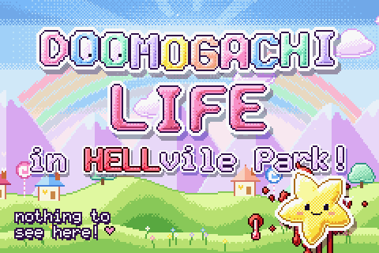
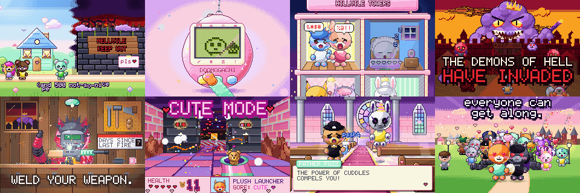
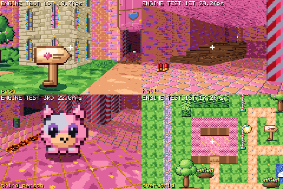
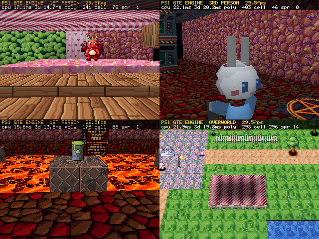
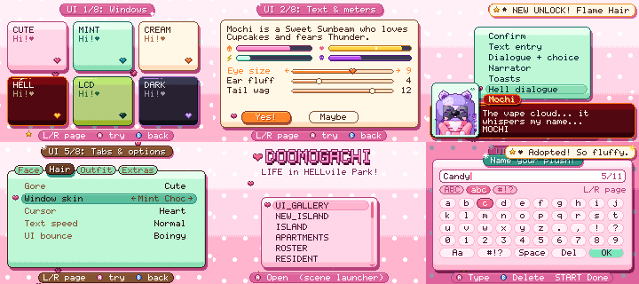

<div align="center">

# DOOMOGACHI LIFE in HELLvile Park!

**Tamagotchi × Tomodachi Life × DOOM, as a real Game Boy Advance ROM and a real PlayStation disc.**

[](https://github.com/masong0508-lab/DOOMOGACHI-LIFE-in-HELLvile-park-exclamationmark/actions/workflows/ci.yml)
[](https://github.com/masong0508-lab/DOOMOGACHI-LIFE-in-HELLvile-park-exclamationmark/actions/workflows/release.yml)
[](https://github.com/masong0508-lab/DOOMOGACHI-LIFE-in-HELLvile-park-exclamationmark/releases)




*A Dippinn Productions game*

</div>

---

## What is it?

Welcome to **HaHaland**, the cutest place on earth: candy-coloured cottages,
cafes, flower beds and a big pastel park where everything bounces. At its
heart lies **Hellvile Park**, split down the middle by a river and a big
ugly Wall:

* **Hillvile**, the good side, home of **500 good citizens**: bakers,
  nurses, grannies, sweet goths, cherubs, plushies and frogling mail carriers.
* **Hellvile**, the bad side, built on top of a sealed hell gate, home of
  **500 bad citizens**: imp accountants, ghoul landlords, skeleton
  bureaucrats, vape demons and petty villains, plus a few who are
  secretly lovely.

That makes **1000 premade citizens**, each with a unique look, name, job,
bio, personality, voice and relationships. They are soft, plush
critter-folk (cat, fox, bunny, bear, pup and owl folk alongside imps,
ghosts, skeletons and slimes), and they are always animated: breathing,
blinking, ear twitches and tail wags.

You live there. You make friends, set people up, feed and comfort them,
and you raise your own **Doomogachi**, a tamagotchi on an LCD-green screen
that grows into one of 16 forms depending on your care: cute, angel, feral
or demon.

Then a suspiciously charming shop called Cloud Nine Vapor opens next to the
Wall, the citizens start acting weird, and **the demons of hell invade
(wherever you are)**. The pastel world rots, the music turns metal, and the
game becomes a shooter, which you can play in **first person or third
person** and switch at any time. Stairs, ledges, lifts, look up and down,
jumping, dodge-rolls, a chase camera, and your own customised citizen
running around with a gun.

* **Cute vs. brutal.** Every weapon and the gore setting can be CUTE
  (confetti, hearts, plush stuffing, squeaks) or BRUTAL (blood and gibs).
  We don't judge. (We judge a little.)
* **Welding.** At Rivet's Workshop you weld a frame, barrel, core, sight,
  stock, magazine, charm and paint into your own gun: everything from
  shotguns, railguns and BFG-class cannons to bubble wands, plush
  launchers and lollipop hammers.
* **Exorcisms.** Possessed neighbours get the Church of St. Cuddles
  treatment: a prayer rhythm game, then aiming the holy water, then guessing
  the demon's true name. Fail three times and the soul is lost.
* **The ending.** You beat Lord Vapula, Duke of the Ninth Cloud, cross into
  Hellvile, and redeem, befriend and exorcise your way to peace. The Wall
  comes down and **every citizen from both sides comingles in Hellvile
  Park** for one giant festival. The credits are a parade of all 1000 of
  them.

There is also a Tomodachi-style **Free Play** mode (an empty island you fill
with your own creations, the 1000 premade citizens, or 1000 random ones)
and a huge citizen creator. The full design is in
[docs/GAME_DESIGN.md](docs/GAME_DESIGN.md).

<div align="center">


<sub>Frames from the 78-second teaser trailer. The trailer is pixel animation drawn with the game's real palette; it is <b>not</b> captured gameplay.</sub>
</div>

## Status: playable alpha

Everything below is in the GBA ROM and the PS1 disc that CI builds, and is
covered by native unit tests, scripted playthroughs and headless emulator
runs on both consoles.

| Part | Status |
|---|---|
| Shared C99 core: scenes, UI toolkit, input, options, unlocks, town state, CRC-checked saves | **done** |
| Art pipeline: 256-colour palette, procedural textures, skies, sprites, portraits, chibis, creator figures, third-person fighters | **done** |
| The 1000 premade citizens (500 Hillvile, 500 Hellvile, about 1500 relationships) | **done** |
| **GBA**: Mode 4, height raycaster (3D floors/ceilings, stairs, lifts, doors, look up/down, first and third person), 3D overworld, PSG + DirectSound audio, 128 KB flash saves | **done** |
| **PS1**: GTE polygon 3D engine, 3D overworld, low-poly citizens, SPU ADPCM audio, memory card saves, scene code streamed as CD overlays | **done** |
| Life sim: needs, social life, romance, possession, exorcism, Doomogachi pet, graveyard, Monster Mode | **done** |
| Shooter: 7 Hell Breach levels, 11 demon types, bosses, welding (39 frames, cute and brutal), arena modes | **done** |
| Story mode: 4 chapters, overworld maps, cutscenes, 40+ side quests, credits parade | **done** |
| Citizen creator and Free Play (title, island hub, apartments, roster, care, shop, news, options, unlocks) | **done** |
| Fun Fair minigames, Concert Hall + choirs, Music Studio (lyrics + music editor, 25 singers), dreams, Library, fishing, cooking | **done** |
| Teaser trailer (`trailer/`) | **done** |

Performance (docs/GBA.md, docs/PS1.md): PS1 2D screens run at 29-30 fps
after the speed pass, 3D at 28-30; GBA 3D at 19-29 fps, GBA title screen
still 12-14 fps (next target). Designed but not yet built: see
[docs/design/ROADMAP.md](docs/design/ROADMAP.md) (deep face/body
customization and 150+ options, deeper story with the dream house and
comic-timing engine, dynamic chiptune music with record scratches).

**What you can play today:**

* **The engine-test builds** (`doomogachi-enginetest.gba`,
  `doomogachi-ps1-enginetest.zip`) are a guided tour of the 3D engines. Press
  any button to take control and walk the showcase maps in first or third
  person.
* **The game builds** (`doomogachi.gba`, `doomogachi-ps1.zip`) boot through
  the splash to a developer scene launcher. The UI gallery, dialogs, text
  entry and save/load work. Scenes that haven't been written yet show a
  placeholder. Each module that lands makes the same ROM and disc more
  complete.

## Screenshots (real builds)

**Game Boy Advance**, 240×160, engine test in the mGBA headless harness: a
path in the courtyard, the hall stairs, the third-person camera and the
overworld.



**PlayStation**, 320×240, engine test in PCSX-Redux: a pink hall with an
imp, the third-person camera in hell, a lava pit and the 3D overworld.



**The shared UI**, native runner at the GBA's 240×160: window skins, meters,
a hell dialogue, options, the title and the on-screen keyboard.



## Download and play

**Releases** (tagged versions):
[latest release](https://github.com/masong0508-lab/DOOMOGACHI-LIFE-in-HELLvile-park-exclamationmark/releases/latest).
Every release has the same file names, so these links always point at the
newest full release. Pre-releases, from tags like `v0.2.0-beta`, are
listed on the releases page.

* [`doomogachi.gba`](https://github.com/masong0508-lab/DOOMOGACHI-LIFE-in-HELLvile-park-exclamationmark/releases/latest/download/doomogachi.gba): Game Boy Advance ROM
* [`doomogachi-ps1.zip`](https://github.com/masong0508-lab/DOOMOGACHI-LIFE-in-HELLvile-park-exclamationmark/releases/latest/download/doomogachi-ps1.zip): PlayStation disc, NTSC (`.bin` + `.cue`, plus the `.exe` for side-loading)
* [`doomogachi-ps1-pal.zip`](https://github.com/masong0508-lab/DOOMOGACHI-LIFE-in-HELLvile-park-exclamationmark/releases/latest/download/doomogachi-ps1-pal.zip): PlayStation disc, PAL
* `doomogachi-enginetest.gba`, `doomogachi-ps1-enginetest.zip`: the 3D engine tours
* `SHA256SUMS.txt`

**Bleeding edge, from every commit:** open
[Actions → CI](https://github.com/masong0508-lab/DOOMOGACHI-LIFE-in-HELLvile-park-exclamationmark/actions/workflows/ci.yml),
click the newest green run, and scroll down to **Artifacts**. You need to
be signed in to GitHub to download them.

| artifact | contents |
|---|---|
| `doomogachi-gba` | `doomogachi.gba`, `doomogachi-enginetest.gba` |
| `doomogachi-ps1` | `doomogachi.bin`, `doomogachi.cue`, `doomogachi.exe` |
| `doomogachi-ps1-enginetest` | the engine-test disc |
| `gba-harness-screenshots`, `core-native-screenshots` | what the automated tests saw |
| `doomogachi-trailer` | `trailer.mp4` (when the trailer changed, or on manual runs) |

**How to play:**

* **GBA:** [mGBA](https://mgba.io) is recommended. It detects the 128 KB
  flash save by itself. On a real GBA, use a flash cart with the save type
  set to FLASH 128K / 1M.
* **PS1:** [DuckStation](https://www.duckstation.org) (needs a PlayStation
  BIOS dump) or [PCSX-Redux](https://pcsx-redux.consoledev.net) (also runs
  with its free OpenBIOS). Open `doomogachi.cue`. On a real PlayStation the
  disc is unlicensed, so it needs a modchip, a softmod (Unirom, tonyhax
  International, FreePSXBoot) or an optical drive emulator.

There are more details, including real hardware, in
[docs/BUILDING.md](docs/BUILDING.md#playing-the-builds).

## Controls

The core uses one set of buttons and each console maps them:

| Core button | Game Boy Advance | PlayStation |
|---|---|---|
| A: confirm / fire | A | Cross |
| B: back / jump | B | Circle |
| X | SELECT + A | Square |
| Y | SELECT + B | Triangle |
| L / R: strafe, tabs | L / R | L1 / R1 |
| L2 / R2: look down / up | (hold L + D-pad) | L2 / R2 |
| START: menu / pause | START | START |
| SELECT: first ↔ third person | SELECT | SELECT |
| Move | D-pad | D-pad or left analog stick |

Shooter controls from the design: D-pad moves, L/R strafe or lock on, A
fires, B sprints and jumps, SELECT toggles the camera, START pauses.
On PS1, Square rolls and Triangle switches weapons.

**Engine-test builds:** the tour plays by itself, and any button takes over.

* **GBA:** D-pad walks and turns, L/R strafe, hold A + Up/Down to look up or
  down, B jumps, SELECT switches first/third person, START resumes the
  tour. Hold SELECT while booting to run the flash save self-test.
* **PS1:** D-pad moves and turns, L1/R1 strafe, L2/R2 look down/up, SELECT
  switches first/third person, START goes to the next scene, Triangle
  toggles the performance HUD, SELECT + START runs the memory card
  self-test.

## Build it yourself

Short version, on Ubuntu 24.04 / Debian (or WSL2):

```sh
sudo apt install build-essential python3 gcc-arm-none-eabi libnewlib-arm-none-eabi libmgba-dev \
                 gcc-mipsel-linux-gnu g++-mipsel-linux-gnu binutils-mipsel-linux-gnu cmake ninja-build ffmpeg
make doctor      # what was found, what is missing
make             # core tests + GBA ROM (+ PS1 disc once PSn00bSDK is installed)
make test        # every test this machine can run
```

| command | result |
|---|---|
| `make gba` | `gba/build/doomogachi.gba` and `gba/build/doomogachi_et.gba` |
| `make ps1` | `ps1/build/doomogachi.{bin,cue,exe}` and `ps1/build-enginetest/` |
| `make core` | native unit tests and the headless playthrough at 240×160 and 320×240 |
| `make trailer` | `trailer/build/trailer.mp4` |
| `make dist` | everything in `dist/`, with the release file names |
| `make clean` | removes every build directory |

The PS1 disc needs **PSn00bSDK**, built from source at a pinned commit.
[docs/BUILDING.md](docs/BUILDING.md) walks through it, along with macOS
(Homebrew), Windows (WSL2), emulators and real hardware. Each module also
documents its own build: [core](core/native/README.md),
[GBA](docs/GBA.md), [PS1](docs/PS1.md), [trailer](trailer/README.md).

## Continuous integration

* [`ci.yml`](.github/workflows/ci.yml) runs on every push and pull request,
  and can be started by hand:
  * **core**: native tests, the same tests under ASan/UBSan, a `-Werror`
    compile of every core file with gcc, arm-none-eabi-gcc and
    mipsel-linux-gnu-gcc, and a check that generated files are up to date
  * **gba**: both ROMs, plus the headless mGBA harness (engine tour, flash
    save round trip, game smoke test)
  * **ps1**: PSn00bSDK built from source at a pinned commit (cached), then
    both discs
  * **trailer**: re-rendered when `trailer/` changes. A manual run can also
    build the 1080p cut with the Dippinn Productions logo.
* [`release.yml`](.github/workflows/release.yml) runs when you push a tag
  `v*` (`git tag v0.1.0 && git push origin v0.1.0`). It builds and tests the
  ROM and discs and attaches them to a GitHub Release. Tags with a hyphen
  (`v0.2.0-beta`) become pre-releases.

## Project layout

```
core/            the portable C99 game core, shared by both consoles
  include/doomo/   the contract: every module's public API and data layouts
  src/             implementation, one owner per file
  art/ tools/      procedural art generators (run at build time, output committed)
  gen/             generated const data: art, the 1000-citizen roster, maps
  data/roster/     the 1000 citizens as editable text (docs/ROSTER.md)
  native/          headless native runner: software framebuffer, PNG screenshots
  tests/           unit tests, scripted playthroughs, golden images
gba/             Game Boy Advance platform: crt0, linker script, raycaster, audio, flash, libmgba harness
ps1/             PlayStation platform: GTE 3D engine, SPU, memory card, CMake presets, PCSX-Redux harness
trailer/         the teaser trailer, rendered by C code
tools/           python3 generators (stdlib only)
docs/            design, architecture of each platform, art, roster, building
.github/         CI and release workflows, the PSn00bSDK setup action
Makefile         top-level entry points (make / make test / make gba / make ps1 / ...)
```

How the pieces fit together is in [ARCHITECTURE.md](ARCHITECTURE.md).
The game design is in [docs/GAME_DESIGN.md](docs/GAME_DESIGN.md).

## Credits


**DOOMOGACHI LIFE in HELLvile Park!** is **a Dippinn Productions game**. The
Dippinn Productions logo opens the 1080p cut of the teaser trailer.

It is built with [PSn00bSDK](https://github.com/Lameguy64/PSn00bSDK) and
mkpsxiso (PlayStation), the GNU Arm Embedded toolchain and newlib (GBA), and
tested with [mGBA](https://mgba.io) (libmgba) and
[PCSX-Redux](https://github.com/grumpycoders/pcsx-redux) with OpenBIOS.

This is a fan-made homebrew game. It is not affiliated with or endorsed by
Nintendo, Sony Interactive Entertainment, id Software or Bandai Namco.
Game Boy Advance, PlayStation, DOOM, Tamagotchi and Tomodachi Life are
trademarks of their owners. No commercial SDKs or BIOS files are used or
distributed.
