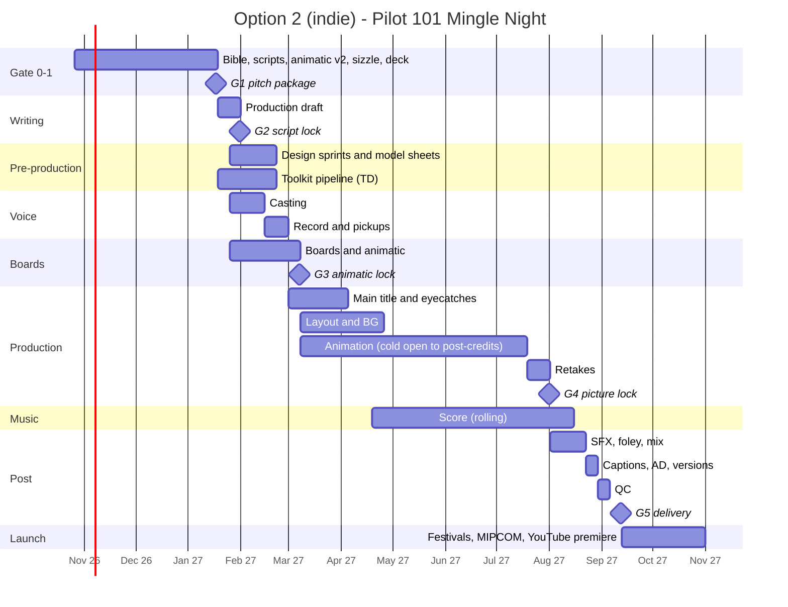

# DOOMOGACHI LIFE in HELLvile Park!: Pilot Production Roadmap

**Episode 101, "Mingle Night"** (event pilot, 22:00, four acts)

| | |
|---|---|
| Version | 1.1, 2026-10-25 (the adult direction: TV-MA, the four hard limits, Grumbleguts' debut in 102; ledger in §1.3a) |
| Status | Roadmap. The pilot spec is locked for outlining. The script is not yet written. Ep 102, "Open Late", is outlined in act beats. |
| Producer of record | Dippinn Productions (entity to be confirmed, see §9 R1) |
| Canon | `docs/design/story/story_final.md` wins every conflict. After it come `docs/STORY.md`, `docs/ROSTER.md`, the shipped Ch1 script `core/data/story/ch1/*.dsc`, `bible_heart.md`, `bible_horror.md`, `comic_timing.md` and the Grumbleguts docs, adopted within the show's four hard limits (§2). |
| Inputs | Pitch C, "Mingle Night", won both judge panels (8.36 and 8.21). This roadmap applies the grafts from Pitches A and B and resolves the points where the judges disagreed (§1.4). |
| Theme | "Doomtastic Times" is being produced in parallel and will be published to `docs/show/theme/`. The plan uses two cuts: the main title (about 45-55 s, boarded here at 0:50) and the TV size (about 1:30). |

Calendar dates assume Week 1 starts **Monday 2026-10-26**. Episode numbers: three-digit numbers (108) are TV episodes; "Ep 2.6" style numbers are the game's chapter episodes that the show adapts. The front door to all the show documents is `PILOT_ROADMAP.md`.

---

## 0. At a glance

| | |
|---|---|
| **What** | A 22-minute 2D pixel-art animated pilot. One Midsummer night carries the whole show: the cozy life-sim, small-town comedy, the mystery, horror, a cute/brutal run (HaHaland's filter, then the truth), and heart. |
| **Audience** | Adult animation, made for adults. Secondary: retro-game players and the game's own audience. Not made for kids, and not pitched to children, teens or family co-viewing. |
| **Rating** | **TV-MA.** This episode is **TV-MA (V)**: DOOM gore on demons and monsters, through the filter and the truth. The series is **TV-MA (L, S, V)** from 102. 18+ elsewhere (16+ where a territory's scale allows). Grumbleguts is not seen in the pilot: a silhouette, a gurgle and a purr. He debuts in 102. |
| **Look** | Native 16:9 pixel art at 384x216, scaled by whole numbers to 1080p (5x) and UHD (10x). 29.97 fps, using the game's 256-colour palette as the colour script. |
| **Sound** | The "Doomtastic Times" main title, a leitmotif score built on the game's E-E-G cell, eyecatch stings, a comedy SFX kit, a stereo and 5.1 mix, and audio description. |
| **Gates** | G0 decisions (W1). **G1 pitch package (W12, 2027-01-17)**. G2 script lock. G3 animatic lock. G4 picture lock. G5 delivery. G6 launch. |

### Three ways to make it

| Option | Team | Cash budget | Delivery | Premiere target |
|---|---|---|---|---|
| **1. Solo creator + AI-assisted tools** | The creator, plus freelancers for voice, theme, mix and legal | **$8k-65k** (typical $26k, §6.1) plus about 18 months (78 weeks) of the creator's time | W78 (Apr 2028), with an 8-week buffer before the premiere | **Midsummer 2028**, the week of 2028-06-19, which is the show's own holiday |
| **2. Indie team of 5-8** (recommended if about $200k or more can be committed by W12) | Core crew of 6-8 plus freelancers | **$187k-543k** (mid case $340k: every line at its midpoint, with the creator's fee deferred, §6.2) | W46 (Sep 2027) | Halloween week 2027 (W53) on YouTube (age-restricted, with a green-band teaser for discovery), or held for a festival premiere. A Midsummer 2027 teaser releases the main title. |
| **3. Studio co-production** | A partner studio's crew, with the creator as EP | **$0.75M-1.9M** (mid case $1.2M, §6.3), partly offset by tax credits | Deal + 48 weeks | Set by the buyer. Pitch Midsummer or Halloween 2028. |

**Decision rule.** Every path runs Gate 1 (W1-W12) the same way, because the pitch package is what raises the money. At W12:
* if about $200k or more is committed, run Option 2 (at $200k it runs at the low case: low-end rates and the creator's fee deferred; the mid case needs about $340k);
* if not, run Option 1 and keep pitching;
* if a buyer bites, switch to Option 3.

All work done on the solo track (bible, script, animatic, designs, toolkit upgrades) carries over to the other two.

### What "well produced" means for this pilot (the production-value priorities)

1. **A real ensemble voice cast**, recorded together where the comedy needs it. Temp TTS is never heard outside internal animatics.
2. **An anime-grade opening.** "Doomtastic Times" is cut to picture on the egg-crack downbeat. Its pre-chorus is the mirrored knock. The opening changes as the series goes, and the TV size comes back as the Act Three insert song.
3. **Real camera language at 16:9**: integer-step parallax, crane-ups, whip pans, heart and circle irises, the hellify rot, and the brick wipe at the Wall. This replaces the trailer's fixed 3:2 frames.
4. **Lighting by the hour**, so the night visibly progresses, using the palette's NIGHT tint and emissives (lanterns, the ribcage, the firework).
5. **A hi-fi score.** The chiptune core is re-rendered at 48 kHz stereo, with live layers on top: a choir for TRUE NAME, guitars for the brutal register, and a real xylophone for Bonejangles' ribs.
6. **Comedy timing enforced to the frame** (the R2-R26 ladder), alongside three gag-free holds that are protected.
7. **Accessibility as craft.** The silent lead makes audio description essential. Captions carry the show's own jokes ("[beep.]", "[GURGLE: gurgle.]"), and SDH carries the gore and the purr ("[wet crunch]", "[squelch]", "[low purr]").
8. **QC that protects the look**: a palette lint on every frame, integer scaling only, a 4:4:4 master, PSE/Harding checks, and broadcast loudness.

---

## 1. The pilot we are making (locked spec v1.2)

### 1.1 Logline

At the Midsummer Giggle, the half-a-festival HaHaland throws on the anniversary of the night it walled off the other side, a silent newcomer and a just-hatched pet that only says "beep." must save the town's skeleton bandleader from a rhyming demon. The cure turns out to be a name nobody on this side is allowed to say.

### 1.2 Rundown v1.2 (matches `PILOT_BEATSHEET.md`, the timing source)

`PILOT_BEATSHEET.md` times all 60 beats and proves the total; where this section and the beat sheet ever differ, the beat sheet wins.

| TC in | Segment | Length | Ends on |
|---|---|---|---|
| 00:00 | **Cold open: "The Last Mingle"** (crayon, match-cut to pixel) | 1:40 | The egg cracks on the theme's first downbeat |
| 01:40 | **Main title: "Doomtastic Times"** (main title cut) | 0:50 | Title card GIGGLE NIGHT, with MINGLE showing through the wet paint |
| 02:30 | **Act One: "18:00 Welcome!"** | 5:20 | Bonejangles' ribcage lit purple. "...Clack." |
| 07:50 | Eyecatch pair 1 (OUT 5 s, IN 5 s) | 0:10 | |
| 08:00 | **Act Two: "21:00 (we don't do that)"** | 4:15 | A paw on Rivet's prize case ("TOP PRIZE. Please don't. —R"). "beep." The glass cracks |
| 12:15 | Eyecatch pair 2 | 0:10 | |
| 12:25 | **Act Three: "22:00 ~~Bedtime!~~ weather"** | 4:15 | "We'll wait." |
| 16:40 | Eyecatch pair 3 | 0:10 | |
| 16:50 | **Act Four: "23:00 ________"** | 3:55 | The answering firework, and the hum one note further. `[NO BUTTON]` |
| 20:45 | **Tag: "Morning"** | 0:35 | "...He's teething." |
| 21:20 | End credits (music-box arrangement of the hook) | 0:30 | The card has peeled to read MINGLE NIGHT |
| 21:50 | Post-credits: the gate | 0:10 | GURGLE: "...needs salt."; his purr; "gurgle." on the Dippinn card |
| | **Total** | **22:00** | 1,320 s = 39,600 frames at 30 nominal |

**What changed from v1.1** (the first draft of this roadmap), with the total unchanged: the cold open lost 10 s when its red-eyes insert became the crayon empty hand (no OMINOUS cue before the fog); Act One gained 20 s for the three speech pages and the lost-property lantern; Act Two lost 15 s; Act Four gained 10 s for the grave, the old-draft page and the split; the tag lost 5 s. (-10 +20 -15 +10 -5 = 0.)

**Production metrics.**
* About **270 shots**, averaging 4.5 s (the cold open alone is 21 shots averaging 4.8 s, `COLD_OPEN_SHOTLIST.md`).
* About **1,000-1,200 board panels**.
* A script of 32-38 pages.
* **12 speaking roles** (beat sheet Appendix E): 11 cast principals plus GURGLE (Grumbleguts' actor's processed babble). The purr after the credits is non-speaking (`PILOT_ROADMAP.md` D8). The fog's voice is the walla group stacked with Clinker's actor, and the walla group is 4-6 adult performers.
* **70 s of first-person footage** (3-03 and 3-05), under the 1:15 cap.
* **3 truth inserts** (12 frames in all: 2-03, and two in 3-01) and **1 sticker** (3-03, shot off the HUD).
* **3 gag-free holds**, protected: Fuzz on the steps, "...Seven.", and the firework.

**Where the grafts land, by beat** (beat IDs from the beat sheet):
* **Act One:** 1-02 the "1" falls off and the pencilled "and Sunny."; 1-03 S107 page 1 in the fountain basin; 1-04 to 1-07 the Giggle crawl cut to 4 stalls (52 s; Grampy in the background without a line); 1-09 page 2 under the twin pies and the horned key; 1-10 the LOST PROPERTY lantern; 1-11 page 3 in Mascotty's paw after R21 of stillness; 1-13 the 4-frame pipe-sigh insert; 1-14 Fuzz's kids'-tent insert, **with no string on the crowned silhouette**.
* **Act Three:** 3-01 the cute run (0:50, elastic +/-20 s, with two 4-frame truth inserts that are never trimmed); 3-03 and 3-05 the first-person runs (40 s + 30 s), in the truth.
* **Act Four:** 4-03 **"Something was in there with me. It kept trying to finish a poem."**; 4-04 **"...I got lucky."** [R13] **"Luck isn't a liturgy."**; 4-05 the old draft, **"You never asked where it went."**, "Old draft."; 4-07 **Fluffy's grave**, with a cupcake on it; 4-08 the pink heart and **the 2 s half-split** (a sooty hand, a fuse, two bowls, no faces), then the hum one note further.

**Post-credits (0:10).**
1. Night at the sealed gate. The grille, its shutter shut, is in frame throughout (the plant for 102).
2. The stray Giggle lantern drifts over the Wall **carrying the pink "1"**. R13.
3. A wet *crunch*.
4. GURGLE, and the padlocks rattle three times, 15 frames apart.
5. Topper at R13: *BOING*.
6. A deadpan caption, attributed to GURGLE (it): **"...needs salt."** Then his purr behind the gate (`PILOT_ROADMAP.md` D8). Grumbleguts is not seen.
7. Smash to the Dippinn card, which says "gurgle." on its last frame.

HaHaland stays at **Population 500** as a running gag until the finale's "Population: 1,001."

### 1.3 Graft ledger: what changes from Pitch C

| # | Change | Source | Lands in |
|---|---|---|---|
| G1 | **Pump Shotgun becomes the Pump Sprinkler from day one.** Same squeak-CHK, sprinkle shells, never aimed at a citizen, never merchandised. **The Bubble Wand leads the merchandise.** **Superseded by M3** (§1.3a): the Pump Shotgun is restored. | Both judges | Act Two prize case, Act Three, all art |
| G2 | Clinker line: "Something... It kept trying to finish a poem." "...She?" is cut. | Judge 2 | Act Four |
| G3 | Fuzz explains the win away as luck ("I got lucky. Luck isn't a liturgy."). The bible flags the pilot's name as a **lucky shout, not a true rite**, so "The Bottle" (game Ep 2.5, TV 107) is still the first real one. | Both judges | Act Four, bible |
| G4 | The **S107 "Speech Notes"** runner: three pages found (fountain basin, under the twin pies, in Mascotty's paw after Sunny stands still for R21). "Two." is the rating for the recovered speech. The old-draft page sits on the back of the clipboard. | A, via both judges | Acts One, Two and Four |
| G5 | The Giggle crawl is cut to 4 stalls. Grampy loses his line and returns in Ep 103 ("Three Neighbours"). | Both judges | Act One |
| G6 | The pencilled "and Sunny." under the 501 | Judge 2 (from A) | Act One |
| G7 | The pink "1" crosses the Wall in the post-credits, and Population 500 becomes a running gag | B | Post-credits, series |
| G8 | A 4-frame pipe-sigh insert at 21:00, as a rewatch clue for Ep 3.4 | B, via Judge 1 | Act One |
| G9 | Fluffy's grave beat replaces the crowned-shape-with-string insert. **No crowned silhouette in the pilot has a string.** | Judge 2 | Acts One and Four |
| G10 | **Wall-wipe grammar is a series rule.** The camera can cross the Wall and nobody else can. The split screen closes for good in the finale. | B | The firework answer, then the series |
| G11 | **The main title is a living opening.** One detail updates per arc: the glow blinks back after Arc 1, the gate has a crack after Ep 2.7, the pipes show under the town after Ep 3.4, and the finale's pan has no Wall. The pre-chorus is a **mirrored knock**, with the Hellvile side in silhouette only until canon reveals it. | A and B | Main title |
| G12 | The eyecatches keep C's festival-clock cards and add **Mascotty's season runner**. She appears in every IN card, a little closer each episode, and the head comes off only at Ep 4.6. | A | Eyecatches |
| G13 | **Standards discipline**: ~~TV-PG~~ (the rating is superseded by M1); inserts never shorter than 4 frames; flashes no longer than 3 frames at reduced luminance; a Harding/PSE pass. **No OMINOUS cue before the fog**, so the 21:00 fog is the first real scare. Everything but the rating stays. | A | Whole episode |
| G14 | **The season plan shows the work that follows.** Eps 102-104 take Pitch A's quiet material almost unchanged: the Pink Door Cottage, COSY: B+, the S199 "Thursday" brick, "Neither did I." | A | Bible, deck |
| G15 | **The format changes over the series.** Before 107 "The Bottle", episodes are single 22-minute Hillvile stories. After it they become 2x11 with a Hellvile B-segment ("the same day from the other side"), which stays away from the gate's inside until Ep 2.7 (the keeper and the gate's Hellvile face are seen from 102, M6). The finale closes the split screen. | B | Bible, deck |
| G16 | **A Grumbleguts model sheet, commissioned now**, first briefed as a buttoned-up uniform (a cap, a vest, trousers, the gate key on a chain, a NO sign) for the old family audience. **Superseded by M5** (§1.3a): the sheet is drawn in the game's look. | B | Pre-production. Used for the main-title silhouette. |
| G17 | **Deliverables**: the "[GURGLE: gurgle.]" and "[beep.]" caption gags, **mandatory audio description**, and a per-language localization guide covering the they/xe pronouns, "beep." and the lyrics. | B | Post |
| G18 | **Scope trims**: first person no longer than 1:15 and built on the s10 raycaster; a single emissive-ribcage layer; about 12 speaking roles; the trailer scenes reused as Pitch C lists them. | Both judges | Pipeline |
| G19 | **Chibi preset fixes before any pitch art**: the Mayor is a cherub, Nana a sheepkin, Pip a bunnykin and Sunny a bunnykin. | Judge 2 | W1 |
| G20 | **Comps are cleaned up** for a family audience: Shaun of the Dead and Hazbin were dropped and five kids' and family comps used instead. **Reversed by M8** (§1.3a): the comps are adult and tonal only. | Judge 1 | Deck |

### 1.3a The mature direction (2026-10-25), which supersedes G1, G16 and G20 and part of G13

The user re-pointed the show at adult animation: "The show won't be rated for kids. So add the butt gag back." / "It's supposed to have the gruesomeness of DOOM, so naturally there is leeway for maturity." / "Remember Grumbleguts can be as promiscuous as someone like Angel Dust sometimes." / "Bar censor stickers as much as you can." / "Maybe save Grumbleguts' appearance for the next episode." The pilot's beats keep their lengths (22:00, 60 beats, 1,320 s); every change sits inside an existing beat.

| # | Change | Lands in |
|---|---|---|
| M1 | **Rating and audience.** Adult animation, made for adults; TV-MA (the pilot TV-MA (V); the series TV-MA (L, S, V) from 102); 18+ elsewhere, 16+ where a territory's scale allows; not made for kids. The 10-16 core, family co-viewing, the TV-PG ceiling and the "D first in the finale" delay are gone | §0, §2, deck slide 16, every rating row |
| M2 | **The four hard limits**, the show's own non-negotiables: nothing explicit; adults and consent; children never in it; no real-world hate content | §2 (first), the bible's standards appendix, every script, board and animatic |
| M3 | **The Pump Shotgun is restored** (the game's canon brutal weapon, Rivet's junk-welded build); the **Bubble Wand stays** as the cute-mode weapon, no longer a substitution or the merchandise lead. Each weapon carries the game's two names (PARTY PUMP / SLAUGHTER; the optional welded saw, PURRING SAW / MEATCLEAVER, is `PILOT_ROADMAP.md` D15) | Act Two prize case, Act Three, the HUD, props, foley |
| M4 | **HaHaland's filter and the truth.** The game's CUTE/BRUTAL toggle is the device: the filter shows confetti, the truth shows DOOM gore on demons and monsters, and the gag is the switch. The truth shows in the brutal register, in 4-frame truth inserts, on Hellvile's side of the Wall and in the main title's chorus. The filter is always on with a child in frame. Per-beat upgrades are in `PILOT_BEATSHEET.md` | §2 Gore, §4.3 FX, §4.6, the beat sheet |
| M5 | **Grumbleguts' character and the game's look.** Flamboyant, shameless, flirty and promiscuous; hookups off-screen and implied, with willing adults; the butt gags in full (the restored bagel bend, the X pucker, the blush). The model sheet is drawn in the game's look: harness, collar, studs, chains, the riding crop, the gate key, a bare cartoon butt and a smooth front | §2 Grumbleguts, §4.3, §4.5, `GAG_BIBLE.md` §7 |
| M6 | **Not seen in 101; debut in 102 at the grille; 113 as his turn.** In 101 he is a rear silhouette in the main title and a gurgle and a purr after the credits. 102, "Open Late", is built around him. The town sees him only through the gate's grille, and the gate stays sealed until 113 | §1.2, §1.5, §1.6, `SERIES_OVERVIEW.md` §5 |
| M7 | **The season moves.** 102's old quiet material moves without loss: the cottage and the Thursday tag stay in 102; the beach, Mr. Flops and the first paper boat open 103; Pip's shoebox bed goes to 104. Each of 103-112 gets a small Grumbleguts beat | `SERIES_OVERVIEW.md` §5, deck slides 11-12 |
| M8 | **Comps, buyers, markets, the YouTube route.** Adult tonal comps only (never copied designs, names or lines); adult slates; Kidscreen and the kids' and family slates dropped; YouTube as not made for kids, age-restricted, with green-band and red-band cuts | §4.9, deck |
| M9 | **No censor stickers.** Staging, framing, props, silhouettes, smash cuts, reaction shots, off-screen sound and implication do the work. One survives in the pilot (3-03), because the sticker is the joke and the first shell blows it off. The main title's end pose uses the Mayor's pink roller instead | §2 Stickers, §4.3 FX, §4.6, deck slide 1 |
| M10 | **The theme note.** The cute theme over a brutal show is part of the joke; nothing in the theme package changes | §4.6 |
| M11 | **The cast is adults only.** Pip and every child voice, the walla included, are adults; breakdowns disclose the adult material; one performer voices Grumbleguts and GURGLE in the line the GURGLE vocalist held | §4.5, §6, R21 |

### 1.4 Where the judges disagreed, and how this roadmap resolves it

| Question | Judge 1 | Judge 2 | Locked |
|---|---|---|---|
| Does anything speak at the gate in the post-credits? | Grumbleguts is not seen and does not speak | An offscreen "...Needs salt." | **Locked, then revised by the user's direction (v1.1; the old lock had no voice at all and a pure gurgle as its fallback):** he is unseen; "...needs salt." stays a deadpan caption attributed to GURGLE (which also closes the ratings runner), then his purr behind the gate. *Fallback:* one spoken line, "Mm. Somebody new." (`PILOT_ROADMAP.md` D8). |
| The answering firework | A 2 s half-split: hand, two bowls, no faces | A 4-frame brick-wipe insert of a sooty hand | **Default: a 2 s half-split entered by brick wipe.** The 4-frame version is the animatic alternate, decided at the G3 review. |
| Clinker's line | Keep it, lightly | Change it to "Something... It..." and cut "...She?" | **Judge 2's version**, which is stricter about protecting "The Bottle". |
| "It was the name. Not the hug." | Make it light and add the luck line | Not addressed | **Replaced by the luck line**, which protects Fuzz's Ch3 crisis. |
| Which stall to cut | The Giggle crawl is the first cut | Cut Grampy or Hattie | **Cut Grampy's line.** Hattie stays, because her tent seeds Ep 4.7. |

### 1.5 Room decisions, locked at G0

* **Sunny is they**, an adult (a young adult in their first home). Silent: canon gives Sunny three lines, at Ep 3.7, 4.4 and 4.6. Whether Sunny can be flirted at is `PILOT_ROADMAP.md` D13.
* **The pet is it.** Its name is withheld until Sunny's first spoken line (Ep 3.7). Its vocabulary is "beep.", plus the horned "beep." and "bep?".
* **Pronouns as the roster gives them**:
  * Rivet, Steamy, Mascotty, Nana, Bloom, Hattie, Lulla, Clinker and Charlotte are she;
  * Pip and Wisp are they;
  * Sootkin and Bolt are xe;
  * Kevin, the Mayor, Fuzz, Bonejangles, Grampy and Grumbleguts are he;
  * GURGLE is it.
* **The pilot's host and possessor exist only in the pilot**: Bonejangles (5, he) possessed by the breath of Clinker (753, she). Steamy and TALLYWORN, Sprinklepop and "The Bottle" all stay where canon puts them.
* **Rivet is unseen until TV 108 (game Ep 2.6).** In the pilot she exists as the prize case signed "—R".
* **Grumbleguts' series choices**: his crush is the Gate (story_final), and his catchphrase is "Open late." He is not seen in 101 and debuts in 102, "Open Late"; one performer voices him and GURGLE.
* **The cast is adults only**, Pip included.

### 1.6 The season this pilot sells

| Season | Game chapters | Shape | Ends on |
|---|---|---|---|
| 1, "Something in the Vapor" (13) | P0, Ch1, Ch2 | **101** is the pilot. **102 "Open Late" is Grumbleguts' debut**, at the gate's grille. **103-104** finish Ch1 with Pitch A's quiet material and close Arc 1 on the glow blinking back. **105-113** are Ch2, with **107 "The Bottle"** as the mid-season turn. From 108 the format is 2x11 with a Hellvile B-segment. | The gate cracks (Grumbleguts' turn), and "THE DEMONS OF HELL ARE HERE." |
| 2, "Hell Invades" (13) | Ch3 | The plumbing reveal lands at **S2E7, the series midpoint** | The pet runs over the Wall. "I had a cloud once." |
| 3, "Hellvile Park" (13) | Ch4 + epilogue | Ends on "...Hi, Fluffy.", the Wall falling and the split screen closing | "Population: 1,001." Then the **"Mingle Night" special**, one year to the night after the pilot. |

---

## 2. Audience, rating and standards

**Audience.** Adult animation, made for adults. Secondary: retro-game players and the game's own audience. Not made for kids, and not pitched to children, teens or family co-viewing.

**Rating.** US TV Parental Guidelines **TV-MA**. The pilot is submitted **TV-MA (V)** for graphic fantasy violence (the gore is on demons and monsters). The series is **TV-MA (L, S, V)** from 102, when Grumbleguts brings crude language and sexual innuendo; the network sets the final descriptors. Elsewhere: post-watershed, planned to an **18** ceiling, and **16+** where a territory's scale has that band and its classifier agrees (confirm with each buyer's standards team). One version of the content worldwide; no "safe" alternates are boarded in advance.

### The show's non-negotiables

Four hard limits bind every episode, cut, promo, short, sizzle, deck page and product, in every market. Nothing in the show's adult direction loosens them.

1. **Nothing explicit.** No explicit sexual acts and no genitals on screen, ever. Sex is implied, off-screen or innuendo: a closed door, a sign, a sound, a reaction, a smash cut. Grumbleguts' design has nothing explicit to hide: his front is smooth cartoon with no anatomy drawn, and a bare cartoon butt and the cartoon X pucker are fine.
2. **Adults, and consent.** Every sexual or suggestive moment is between adults and consensual. A no ends the advance on the spot (he steps back on his next line and does not try again in that scene). Nobody's body is used on someone who has not said yes. Silence is never a yes. Consent is never the punchline.
3. **Children are never in it.** Child and teen characters (Pip; the young cherub and the young imp in the storybook flashbacks; Miss Lulla's daycare kids; Bolt, Pokefork, Wisp, Tantrum, Wobbles, Homework; every KID- or TEEN-flagged citizen) are never in sexual or suggestive scenes or dialogue, and never the subject of graphic gore. A scene is one continuous time and place: a scene with a child in it carries no innuendo at all, and graphic gore never shows in a frame with a child in it (the filter stays on).
4. **No real-world hate content.** No slurs, no real-world hate symbols, and no joke whose target is a real group of people, a real faith or a real person.

Everything else is open, and governed by craft: the comic-timing rules, the cute/brutal device, the sticker rule, the Grumbleguts gag book (`GAG_BIBLE.md` §7) and the technical rules below.

**Supporting practice.** The cast is adults only: Pip, the fog's child "us" and every child in the walla are voiced by adults. Casting breakdowns disclose the adult material. The bible keeps a KID/TEEN flag on every citizen. A standards check (`GAG_BIBLE.md` §11.2) runs on every script, board and animatic.

**Technical rules that stay** (they are broadcast law and viewer health, not age rules): whiplash inserts and hidden images run 4 frames or longer, never 1 (subliminal-image rules, e.g. Ofcom 2.11); white flashes 3 frames at most at reduced luminance; no more than 3 flashes a second; red flashes are local, never full-screen; blood is a held or sliding overlay, never a strobe, and any large saturated-red change goes on the Harding list; PEAT on every cut and a Harding/PSE pass before delivery (Ofcom 2.12).

### How the rules apply in production

| Area | Rule in this production |
|---|---|
| **Gore** | **HaHaland's filter, and the truth.** On the Hillvile side a demon pops into confetti, hearts, plush stuffing and grape goo (the filter); the truth is DOOM: blood, gibs, viscera, eyeballs and teeth, shotgun and chainsaw mayhem, the big red splatter, timed on the comic-timing ladder. The gag is the switch. The truth shows in the brutal register (the record scratch into first person, the HUD, the metal insert song), in a 4-frame **truth insert** that owns the audio and cuts back with exactly one persistent change, on Hellvile's side of the Wall (which has no filter; from 102, Grumbleguts' side of the gate) and in the main title's chorus. The filter is always on when a child is in frame. A cute citizen is never gored. Gore lands on a beat and gets a button. The switch always has a sound: SCRATCH in, REWIND out. A hit on Sunny reads on the lens (demon blood, a heart off the HUD); Sunny is never seen hurt, and the pet is never harmed. Blood comes from the palette's BLOOD ramp only where the truth shows, and splatter slides off the lens on twos. First person stays capped at 1:15 an episode. Monster Mode is no longer barred (no Season 1 episode uses it). |
| **Weapons** | **The Pump Shotgun** (canon): Rivet's junk-welded build (a bath-house bellows, a drainpipe, a bike bell), with no real-model silhouette; a squeak in the filter, CHK-CHK in the truth; name plate PARTY PUMP / SLAUGHTER, which flips with the register. The **Bubble Wand** is the cute-mode weapon. The welded saw (PURRING SAW / MEATCLEAVER) is `PILOT_ROADMAP.md` D15. Aimed only at demons, never at a citizen (the hosts are neighbours). No replica-firearm merchandise (retail law): the shotgun only as a non-replica figure accessory. |
| **Possession and religion** | Possession can be properly frightening (stillness, red sockets, the lit ribcage, a doubled voice; the 180-degree head turn is canon in 107); the host always comes home whole (canon). The rite is hugs, a hymn and water, never mocked. Pentagrams are allowed as hell décor; the 4-frame pentagram edit to trailer scene s04 is no longer required. Hell décor is never aimed at a real faith (hard limit 4). |
| **Kids** | Hard limit 3, for production: the cast has no minors; every citizen carries its KID/TEEN flag; the scene split (a scene with a child in it carries no innuendo at all); the filter is on in every frame with a child; kid peril can be real, never graphic gore; the fog never touches a child and no child is possessed (canon). Fireworks staging stays: an adult lights the rocket, and the kid stands three (then four) steps back. |
| **Grumbleguts** | **Not seen in the pilot**: a rear silhouette behind the gate's shut grille in the main title, then a gurgle and a purr after the credits. He debuts in 102, "Open Late". Across the series: flamboyant, shameless, flirty and promiscuous, in the way of adult animated comedy (double entendres, propositions, bragging); every flirt aimed at an adult, every advance taking its no; hookups off-screen and implied, with willing adults; the belly, appetite and gas gags (gross-out close-ups rationed to 2-3 an episode); the butt gags in full (the bagel bend, the X pucker, the blush; every rear reveal gets a record scratch). With a child he is only the grumpy uncle, in a scene with no innuendo in it. The S186 Feast outcome stays game-only as written (`PILOT_ROADMAP.md` D17); the show's version is the post-Season 3 consent rewrite (`SERIES_OVERVIEW.md` §6.1). Gag book: `GAG_BIBLE.md` §7. |
| **Stickers** | **No censor stickers or bars.** Non-explicitness comes from staging, framing, props, silhouettes, smash cuts, reaction shots, off-screen sound and implication; the hard limits mean there is never anything explicit to hide. A sticker may appear only where the sticker itself is the joke, at most once a season: Season 1's is in 101 (3-03), where the Board of Decency sticker slaps over GORE: BRUTAL and the first shell blows it off. HaHaland's own covering habit (GIGGLE over MINGLE, the Mayor's pink paint, the Board's doilies) is the in-world censor, and it always fails. |
| **Vaping** | The pilot has only the Cloud Nine "COMING SOON" sign. In the series, vaping is always the villain's lure and never glamorised (satire). No real brands or devices. |
| **Flashes and inserts** | Inserts are **4 frames or longer**, never 1 (Ofcom rule 2.11 on subliminal images). White flashes last at most 3 frames, at reduced luminance; red flashes are local. Blood is a held or sliding overlay, never a strobe, and large saturated-red changes go on the Harding list. A PEAT self-check runs on every cut, and a Harding pass runs before delivery (Ofcom rule 2.12 / PSE). |
| **Sound** | No OMINOUS cue before the fog. The first real scare is the 21:00 fog. |
| **Third-party references** | `docs/design/story/refs/*.webp` (a pot-bellied devil, Baloo, a dragon demon, the Red Guy) are for inspiration only. They **never appear in pitch or show material**. Comparable shows are tonal only: no copied designs, names or lines (R28). |

A **standards appendix** in the bible restates the four hard limits first, then these rules. It is sent to every writer, board artist, animator, performer and vendor, and to each buyer's standards team at the first meeting.

---

## 3. Stage gates

| Gate | When (Opt 2 / Opt 1) | Exit criteria |
|---|---|---|
| **G0 Decisions** | W1 / W1 | • `docs/show/bible/DECISIONS.md` holds §1.3-1.5 and the answers to the open decisions in `PILOT_ROADMAP.md`.<br>• The slug-reel animatic built from the beat sheet's 60 rows renders at 22:00 and has been watched in real time. |
| **G1 Pitch package** | W12 / W12 | • Bible v1 with the standards appendix.<br>• The pilot script at pitch draft.<br>• A full 22:00 animatic v2 with temp sound.<br>• A 60-90 s sizzle with real voices and the theme.<br>• Deck v2, one-pager and key art.<br>• A trademark opinion on the title.<br>• The chain-of-title inventory.<br>• Budget and schedule for the chosen option. |
| **G2 Script lock** | W14 / W14 | • The production draft, with scene numbers and dialogue IDs.<br>• Canon, standards and pronoun passes signed off.<br>• Estimated story runtime (cold open, acts and tag) within ±30 s of the beat sheet's 20:00. |
| **G3 Animatic lock** | W19 / W24 | • 22:00 exact, cut to the recorded dialogue, with temp score and SFX.<br>• Every shot numbered.<br>• The firework A/B and other alternates decided.<br>• Standards notes cleared. |
| **G4 Picture lock** | W40 / W74 | • Every shot final.<br>• Palette lint clean.<br>• PEAT pass.<br>• Textless versions rendered.<br>• Credits final. |
| **G5 Delivery** | W46 / W78 | • Mix, M&E, captions, AD and every version (§4.8) pass QC.<br>• Harding certificate.<br>• Paperwork complete. |
| **G6 Launch** | W47-W53 / W79-W87 | • Release strategy executed: festival first or YouTube first (§4.9).<br>• Buyer screenings booked. |

---

## 4. Phases

### 4.1 Development: bible, treatment, pitch

**Goal.** A package that sells the series engine, not only the pilot.

**Work.**
* **Series bible v1** (25-40 pages):
  * the one-breath premise;
  * HaHaland, the Wall and Hellvile, and the rules: possession, the three-part rite, the three candles, the Wall wipe;
  * the cast, with species, pronouns, an age band and **KID/TEEN flags**, plus voice notes taken from the roster sliders;
  * tone and the comedy-timing rules, taken from `comic_timing.md`, and the cute/brutal device (HaHaland's filter and the truth);
  * the standards appendix (§2: the four hard limits first);
  * the season map (§1.6), including the format change after 107, 102 "Open Late" (Grumbleguts' debut) and the 103-104 plan from Pitch A;
  * the look (palette and colour script) and the sound (leitmotifs and the theme);
  * the game, a real GBA ROM and PS1 disc, as transmedia.
* **Treatment**: 3-5 pages of the pilot in prose, the night told hour by hour.
* **Pitch deck**: see §4.9.
* **Canon register**: every pilot invention flagged against story_final.md, continuing Pitch C §15:
  * the Midsummer Giggle;
  * the sign-up sheet;
  * the MINGLE crate;
  * the R8-late possessor voice;
  * Clinker's breath;
  * the grille in the sealed gate;
  * Grumbleguts' debut moved to 102 (game Ep 2.7, TV 113 in canon);
  * the Small Puff (102's leftover demon, paying 101's second IN card);
  * the two-name weapon plates.

**Milestones.**
* Bible v1: W3.
* Treatment: W4.
* Deck v0: W6. Deck v2: W11.

**Exit.** The bible has been read by a standards reader (either a consultant or a structured self-review against §2, the four hard limits first). Every canon flag has a disposition.

### 4.2 Writing: outline, drafts, table read

| Step | Week (all options) | Output | Exit check |
|---|---|---|---|
| Beat sheet v1.2 | Done (`PILOT_BEATSHEET.md`, 60 beats); re-checked W1 | §1.2 as a numbered beat list with R-ladder notes | It times to 22:00 in the slug reel |
| Scene outline | W2-W3 | 8-10 pages, scene by scene, with each scene's clue, gag and button | Canon pass against story_final.md |
| Draft 1 | W4 | Full script (Fountain or Final Draft) | Read aloud by 3-4 people in W5 |
| Draft 2 | W6 | Fixes to structure and density, with Act Four de-crowded | The three gag-free holds are intact |
| Draft 3 | W7-W8 | **Comedy pass** (punchline density per `comic_timing.md` §12, one deadpan per conversation, buttons at 12-25 frames). **Standards pass. Pronoun pass.** | The table read (W8) is recorded and timed, and each laugh is logged |
| Pitch draft | W10-W11 | The version that goes out in the G1 package | |
| Production draft | W13-W14 | Scene numbers and dialogue IDs (e.g. `101_A2_014_NANA`), with a line count for each character | **G2** |

**Writing rules.**
* R-ladder notes stay in the script as timing cues: [R8], [HOLD 13], `{d}`.
* Sunny's actions are written as verbs (looks, points, carries, pours, pumps) so the audio-description writer has a clear hook for each one.
* Every quoted canon line is checked word for word against story_final.md or the `.dsc` files.

### 4.3 Pre-production: design from the game's art

**Sources already in the repo.**

| Need | Repo source | How |
|---|---|---|
| Cast model sheets | `core/tools/portrait_sheet.c` (bust 48x56, figure 48x80, chibi 16x24 with a 4-direction walk, fighter 32x48; 11 expressions; possessed, soul-lost and ghost states) | Render ids 0, 1, 2, 5 (including possessed), 36, 42, 71, 77, 88, 106, 111, 729 (Grumbleguts) and 753 as the base for the show turnarounds. See `docs/PORTRAIT.md`. |
| Show-size chibis | `trailer/tk_chibi.c` (sizes 1-4, 11 expressions, 8 mouths, idle clock) | Add **show presets** (`TK_SHOW_*`) so the shipped trailer stays reproducible, then fix the species (G19). **New presets:** Bonejangles (with one emissive-ribcage layer), Steamy, Mascotty, Kevin, Hattie, Bloom, Lulla, and Grumbleguts (`TK_SHOW_GRUMBLEGUTS`, from the concept sheet). |
| Backgrounds and texture | `artgen --sheet DIR`: 47 seamless 64x64 textures, 5 sky panoramas (PASTEL_DAY, SUNSET, NIGHT_STARS, HELL, VAPE_STORM) | BG tiles and parallax plates |
| Demons | `artgen`: the Puff Demon and Impling, 8 frames each | The swarm, and the Big Puff at 3x with re-drawn detail |
| Palette | `core/src/palette.c`, with its 15 eight-shade ramps and the NIGHT tint | Export it to `.gpl`/`.ase`/`.pal` for Aseprite, Krita, Blender and Harmony. **It is the colour script.** |
| UI | `docs/media/ui_gallery.png` (the CUTE, MINT, CREAM, HELL, LCD and DARK skins) | The CREAM clipboard act cards, name plates, the HUD frame, eyecatch frames |
| Grumbleguts | `trailer/concept/grumbleguts.c` (`trailer/build/ggsheet`) | **Re-staged for the show canvas in the game's look (M5).** The scale shot, the reaction cut, the belly X-ray, the flirt and unbuckle poses, the taunt turnaround and the gas puffs are all reusable. The censor sticker is not used as a cover (§2 Stickers). `gg_storyboard` (the Feast) and the hose close-up stay game-only (`PILOT_ROADMAP.md` D17). |
| Logo and ident | `docs/media/title.png`, `trailer/assets/dippinn_logo.mp4` | Title card and studio ident |

**The design package (exit list).**
* **Characters**, 15 plus the crowd:
  * Sunny; the pet (newborn, then with horn nubs); Mayor Giggs; Nana; Pip with Mr. Flops; Fuzz; Bonejangles (normal and possessed); Bloom; Steamy; Kevin; Hattie; Lulla with her kids; Mascotty; Grampy (background only);
  * Grumbleguts: the silhouette for 101; the full sheet for 102 (turnaround, the 11 expressions, X-pucker and blush overlays, the rump-jiggle secondary);
  * the crayon versions: a small cherub seen from behind, a small imp (no face), and Fluffy on a string;
  * a Hillvile-only crowd built with `tk_random_citizen` on ids 0-499. **No Hellvile citizen is visible in the pilot; Grumbleguts (from 102) is the only one before 108, apart from Tallyworn's faceless back in 107's coda.**
  * Each character sheet has:
    * a turnaround (front, 3/4, side, back, 3/4 back);
    * the 11-expression sheet;
    * a **mouth chart** that maps the 8 chibi mouths to Rhubarb Lip Sync shapes A-H and X;
    * paws and hands;
    * colour models for day, night, possessed, hellified and crayon.
* **Size line-up** of the whole cast against one crowd strip.
* **Props.**
  * Signs and paper:
    * the clipboard, with the old-draft page on its back;
    * the three speech pages;
    * the GIGGLE/MINGLE banner, paint roller and cupcake balloon;
    * the town sign (500 / 501 / the pencil note / the painted-over 1000 / the loose pink "1");
    * the pink ticket.
  * Bake-Off and keepsakes:
    * the twin pies with their blank card;
    * the muffins;
    * the key with tiny horns, in an x-ray version;
    * the egg in its tea towel, with the tag "for whoever's next", and the eggshell halves;
    * the recipe tin, its keepsakes and the Mingle sign-up sheet;
    * Nana's scrubbed pie dish with a burnt cookie.
  * The rite:
    * three candles, in three states, plus the blue bead;
    * holy water.
  * Fun Fair and fireworks:
    * the prize case, the Bubble Wand, the **Pump Shotgun** and (`PILOT_ROADMAP.md` D15) the welded saw, with their cute/brutal name tags;
    * the MINGLE crate and the rocket;
    * the Giggle lanterns, including the stray one;
    * the Hook-a-Duck ducks, including the unknown duck that faces the Wall;
    * the cardboard ghosts;
    * the "NOTHING INSIDE! (we checked) —Mayor" sign;
    * the BAKE TENT sign and its "BAKE TEN" state.
  * Characters' things and the gate:
    * Mr. Flops and the JUNIOR FESTIVAL PATROL sash;
    * Bonejangles' xylophone ribs and the chalk poem;
    * Fluffy's grave ("FLUFFY THE CLOUD. DRIFTED.") with its cupcake;
    * the gate's seven padlocks and its KEEP OUT / FOREVER sign, and the grille with its shutter (shut in 101).
* **Locations.**
  * Arrival, festival and cottage:
    * the bus road, candy hills and town sign;
    * **the festival master plan**: stalls, the Bake-Off tent, the Fun Fair (teacups, Whack-an-Imp), the Absolutely Not Scary House, the bandstand with its boarded south half, the fountain basin, the graveyard path, the Wall and the gate;
    * the Absolutely Not Scary House corridors, built as raycaster maps;
    * the Pink Door Cottage, inside and out;
    * Nana's bakery window.
  * Crayon (cold open):
    * the one park and the bandstand;
    * the Wall-split bandstand.
  * Inserts and the Wall:
    * the 4-frame inserts: fog with eyes, the pipe sigh, the kids' tent in sepia, and the three truth inserts (2-03, and two in 3-01);
    * **the 2 s Hellvile half-split**: a table, two bowls, a sooty hand, no faces.
* **FX sheets.**
  * The filter set: confetti, hearts, plush stuffing, grape goo.
  * The truth set: blood from the BLOOD ramp, gibs, viscera, eyeballs, teeth, and lens splatter that slides off on twos.
  * The truth insert (4 frames, owning the audio, cutting back with one persistent change).
  * The chainsaw geyser (`PILOT_ROADMAP.md` D15).
  * Bubble traps.
  * Fog with eyes and the lantern-out wave.
  * The ribcage emissive.
  * The purple puff with chalk dust.
  * The holy-water pour.
  * The firework heart and its purple answer.
  * Hellify transitions.
  * The R8 crayon bleed.
  * Irises.
  * The Board of Decency sticker and its blow-off (3-03 only).
  * The Mayor's pink paint roller over the red drip, and the bleed-back (main title end pose).
  * The hatch flash (3 frames or less).
* **HUD**:
  * a 32 px strip with hearts on the left and shells on the right;
  * the two-name weapon plate (PARTY PUMP / SLAUGHTER), which flips with the register;
  * the pet's face in five states;
  * the plate "RIP AND TEAR... GENTLY", pending counsel (§9 R3).
* **Style guides**:
  * the pixel rules from `ART.md`: 3-4 tone hue-shifted shading, coloured selective outlines, a cool rim light, dithering only where it reads as fluff;
  * motion rules: co-prime idle cycles; entrances of 4-6 frames with overshoot; plush squashes up to 34%, hardware 18-22%, hell drips and never wobbles, and Grumbleguts alone bounces;
  * the crayon guide: `PAL_CRAYON` with a 2-frame line boil;
  * the LCD guide for the pet;
  * the sepia guide for flashbacks.
* **Colour script by the hour** (from Pitch C §14):

  | Time | Look |
  |---|---|
  | 18:00 | PASTEL_DAY into SUNSET |
  | 19:00-21:00 | NIGHT_STARS with PEACH lantern pools |
  | 21:00 | VAPE floods in from the south, and the red eyes are the only hot colour |
  | The brutal register (the truth) | HELL, BLOOD and LAVA through hellify; BLOOD is the truth's blood. Only where the truth shows: the brutal register, the truth inserts, the main title's chorus and the IN flashes (the cold open's red paint drip, `PILOT_ROADMAP.md` D16, uses CANDY's deepest red, not BLOOD) |
  | The rite | BONE and holy gold against VAPE |
  | 23:00 | A white-pink firework and one purple one |
  | Dawn | PEACH and WOOD |

* **Look-dev test (W3)**: a 20 s proof-of-look shot running from 21:00 into the fog, with lip-sync and palette lint. It compares **384x216** (the baseline) with **480x270** (more room to act, 4x to 1080p and 8x to UHD). The resolution decision is made here and never reopened.

**Exit.** Every asset the boards need is designed. The prop list is cleared (the Pump Shotgun look, the HUD label, the plate text), and the gore density is reviewed against the hard limits and the Harding rules. Every design PNG passes palette lint.

### 4.4 Boards and animatic: what the trailer toolkit can do now

**What already exists.**

`trailer/` builds and runs here (gcc, python3 and ffmpeg are present).
* **Timing.** `timeline.c` is the single source of truth for timing, with one `X(name, secs)` row per scene. Any row without a written scene renders automatically as a weak placeholder slug card. This means **listing the pilot's beats with their durations gives a timed 22:00 animatic straight away**, and real shots can replace the placeholders one by one.
* **Thumbnails.** `--sheet` writes 2x contact sheets, which work as thumbnail boards.
* **Video.** `--raw` pipes frames into ffmpeg.
* **Audio.** `--wav` writes the SFX and score track.
* **Finishing.** `assemble.sh` puts the Dippinn ident in front and pillarboxes the result to 1080p.

**Animatic v0, the slug reel (W1, one to two days; recipe in Appendix A).**
1. Paste the 60 rows from `PILOT_BEATSHEET.md` Appendix F into a pilot timeline beside the trailer's. Names are C identifiers: `e101_1_02` is beat 1-02, the town sign.
2. Replace the placeholder text with a slug card generated from a CSV (`beats_101.csv` holds TC, act, beat and dialogue), with a frame counter burned in.
3. Link the trailer scenes Pitch C reuses as **temp shots** ("rip-o-matic"). Each one needs continuity edits (canon order) before it is shown to anyone outside the team:

   | Trailer scene | Temp for | Edits required |
   |---|---|---|
   | s03 | Arrival | Strip "(and 500 not-so-nice people next door)" |
   | s04 | The hatch | Optional: drop the 4-frame pentagram for the pilot's cute-mode hatch (no longer a standards requirement) |
   | s07 | The fog entering the ribs | Remove the vape product, Vex's lines and "*may contain souls" |
   | s08 | The 21:00 freeze | Remove Vapula rising and the vape |
   | s10 | The Absolutely Not Scary House | Keep the brutal gibs and the shotgun; drop "(We judge a little.)" and the minigun (the prize case has no minigun) |
   | s11 | The rite | Drop SOUL LOST and MONSTER MODE |
   | s12 | The festival crowd | |
   | s15 | The gate | Drop the platform text |
4. Build without the trailer score (`MUSIC_SRCS=""`). The reused scenes keep their SFX.
5. Temp score: game cues rendered with `core/build/runner --script S --wav` (musrender), plus the theme master from `docs/show/theme/` placed at 01:40 with ffmpeg `adelay`.
6. Render the full 39,600 frames by piping raw frames to ffmpeg. No intermediate files are needed, and the render takes minutes.

**Animatic v1-v2 (W5-W8).**
* Draw thumbnail boards in Krita, Storyboard Pro or on paper.
* **Fast route (W5):** cut the panels over the slug reel in DaVinci Resolve. The reel supplies timing and a TC burn-in.
* **Durable route (by W8):** add a tiny indexed-image loader to the toolkit, either a P6 PPM reader of about 40 lines or a Python converter that quantises PNGs to the palette as `.pix` files. The boards then render *inside* the deterministic build, and a re-time in the timeline moves picture, SFX and score together.
* Temp dialogue:
  * **internal cuts** use the creator's own scratch reads or clearly labelled TTS;
  * **anything shown outside the team uses real actors** (the W6 micro-session).

**Fix the toolkit's known hazards before G3.**
* Replace the `FR(n)` beat constants that are duplicated between scenes and `music.c` with a shared **named-beat header**, the way the game's story engine names its beats.
* Lock the **timebase**. Frames are the truth, and seconds are always derived as `f * 1001 / 30000`. Rendering at 30 fps and labelling the result 29.97 drifts **1.3 s over 22 minutes**.
* Move to a 16:9 canvas (TW/TH are `#define`s, but the scenes hard-code their layouts, so reused scenes need re-staging).
* Add a camera layer with integer-pixel pans and parallax.
* Add an external audio track to the timeline.

**Pitch sizzle (60-90 s, available from W5, final at W11).** The sizzle is labelled "pre-production test animation".
1. **Open:** the Dippinn ident, then the crayon caption "Every Midsummer night, the whole park had one party."
2. **Body:** the TV-size chorus of "Doomtastic Times" under a montage built from two sources:
   * re-edited trailer shots (s02, s03, s04, s06, s08, s10, s11, s12, s13), with the edits listed above;
   * **four new toolkit shots, one for each of Pitch C's trailer moments**: the GIGGLE-over-MINGLE rule of three; the hatch in the stampede; the ratings runner ("Six." [R8] "Needs death."), done in the HELL dialogue skin; and the pink heart over the Wall, with its purple answer;
   * a fifth, **the 102 teaser**: the grille slides open, rear first, record scratch, "Well, well. {..}Somebody knocked."
3. **Close:** the title card (s15, re-staged), then "A pilot in development".

Cut the sizzle twice: a **red-band** version for buyers and age-gated posts, and a **green-band 30 s** with no gore and no raunch on screen. Also produce a **9:16 cut** for Shorts and Reels, and clean **5 s eyecatch loops** as standalone posts.

**Boards (production).**
* Rough boards W13-W17 (Option 2).
* Clean boards on the shots that need them: the first-person run, the rite and the firework.
* About 1,000-1,200 panels.
* Board to the R-ladder, and note in the panels any frame counts that are critical to a joke.

**Exit (G3).**
* The animatic is 22:00, cut to the recorded dialogue, with temp score and SFX.
* The A/B alternates are decided.
* A shot list of about 270 shots is loaded into the tracker.
* Standards and canon have signed off.

### 4.5 Voice: casting and recording

**Casting breakdown.** Voice notes come from the roster sliders and the bibles.

| Role | Voice brief |
|---|---|
| **Mayor Giggs** (he) | Sing-song (intonation 29), as expressive as possible. "Hee. Hee." is his wound, so he must play both the joke and the hurt. |
| **Nana Puddin** (she) | Low, slow and warm. "Sweet pea." One R8 look per scene. |
| **Pip** (they, KID) | The highest and fastest voice in the cast. An adult performer who specialises in kid voices. **The production casts no minors.** |
| **Father Fuzz** (he) | High and quick, and sincere at the steps. |
| **Bonejangles** (he) | Low and very expressive, at mid speed (pitch 8, intonation 29). He plays a xylophone on his own ribs. |
| **Clinker** (she, heard and never seen) | Low, slow and flat (pitch 7, speed 6, intonation 5). Her "we" line is recorded both together with Bonejangles and separately: the mix slides her track 8 frames (about 267 ms) late, and "...Seven." is her track alone, **on time**. |
| **Dr. Bloom** (she) | High and soft. |
| **Steamy** (she) | Lilting. Define a fictional lilt, or cast a performer for whom the accent is their own. **No caricature.** |
| **Kevin** (he) | One line ("Yes, three eyes."). Deadpan. |
| **Hattie Haha** (she) | Slow and precise, a comic's timing. "...Yikes." |
| **Miss Lulla** (she) | Low and soothing. |
| **The fog voice** | "come and PLAY with us", with the second "us" in a child's voice. The child's line is recorded by an adult walla performer, not by Pip's actor. |
| **Walla, 4-6 performers** (all adults) | The crowd ripple, "NOT NOW, PIP.", Lulla's kids shouting "BEEP!" |
| **Grumbleguts and GURGLE** (he / it) | One performer: a warm, oily baritone, slow, purring and amused, who can sing and play R-range raunch with total sincerity. The same performer's bass babble, processed over the comedy kit's VOICE_GURGLE (with tuba and a draining sink), is GURGLE. In the pilot: the purr and the babble. A series regular from 102. |

**Who is not cast.** Sunny is silent and has foley only. The pet's "beep." is the game's piezo motif, the one sound kept raw from the GBA.

**Process.**
* Self-tape auditions with sides taken from the pitch draft.
* **Breakdowns disclose the adult material** (gore, raunch, R-range language), and each performer approves their script's content before booking.
* Callbacks in pairs: Mayor with Nana, Fuzz with Bonejangles, Pip with Nana, Grumbleguts with the Mayor (102 sides).
* **Union.**
  * Ask SAG-AFTRA (US), Equity (UK) or ACTRA (Canada) which tier fits: low-budget, new-media or standard animation.
  * Option 1 may run non-union.
  * Every contract carries a **no-digital-replica / no-AI-voice clause** and covers the pitch, the series pick-up and promotional use.

**Recording.**
* **Ensemble sessions** for Acts Two and Four, where the comic rhythm lives. Remote sessions run over Source-Connect or ipDTL.
* Solo sessions for the cameos.
* **Pip's "CLINKER!" is recorded dry and alone**, and it plays unprocessed.
* Pickups follow animatic v2, and ADR follows picture lock.
* Dialogue is logged by dialogue ID, and selects go straight into the animatic.

**Exit.**
* Every line is recorded and selected.
* Releases and contracts are signed.
* The dialogue is edited and checked against the 29.97 timebase.
* Mouth cues for the animators are generated with Rhubarb Lip Sync (open source).

### 4.6 Music: main title, score, eyecatches and SFX kit

**Main title: "Doomtastic Times"** (from `docs/show/theme/`).

**Request this package from the theme team in W2:**
1. the main title cut (about 45-55 s);
2. the TV size (about 1:30);
3. the full-length master, if one exists;
4. stems: lead vocal, BGVs, drums, bass, keys and synths, guitars;
5. the instrumental mixes of both cuts;
6. **a DOOM-side arrangement** of the chorus (for the Act Three insert);
7. a 2-bar hook cut in C major and a minor (RIFF) version, both for the eyecatches;
8. a music-box arrangement of the hook (for the credits);
9. the lyrics, with timing in bars and timecode;
10. a split sheet and the licence (§9 R6);
11. a bar map of both cuts (section starts in bars and timecode), from which the editor cuts the 0:20 short open for the 2x11 version (intro plus end pose).

**Animation board, by song section** (so it conforms to the master when it locks):
1. **Intro.** A crane up over HaHaland (from s02), with the logo dropping on the beat.
2. **Verse.** The cast pops in on the beat: entrances of 4-6 frames with overshoot, and CUTE name plates. Mascotty never pops in; she is simply in every shot, perfectly still.
3. **Pre-chorus: the mirrored knock (G11).** The Hillvile cast runs at the Wall, and on the other side silhouettes mirror them frame for frame. On the same beat, both sides knock. The music's own record scratch lands on the gate.
4. **Chorus.**
   * Hellify rots the shots.
   * The s10 corridor flips from the filter to the truth on the sweetest line (a Puff Demon bursts into red mist across the lens while the vocal keeps smiling).
   * Three candles go out in rhythm.
   * Behind the shut grille, a big round rear silhouette presses against the gate and bounces once, drawn from the Grumbleguts model sheet (M5); the padlocks jump.
5. **End pose.** A split at the Wall; the Mayor's pink roller paints over the red drip, which bleeds back on the last chord; 13 frames of silence, "beep.", and the purple sparkle sinking. *Pilot variant:* GIGGLE NIGHT, with MINGLE showing through. *From 102:* Grumbleguts pops into the verse rear first, with a record scratch, in a verse shot of his own with no child in it.

**The cute theme over a brutal show is part of the joke.** "Doomtastic Times" stays exactly what the theme team is making: bright, sugary, slightly J-pop, with clean, sincere lyrics; nobody rewrites it edgier. The picture does the brutality: the chorus lands the corridor's switch to the truth (blood and gibs across the lens) on its sweetest line while the vocal keeps smiling, and the end pose paints over a red drip that bleeds back through. The Act Three insert song is the same chorus in its DOOM-side arrangement under real gore; the credits are a music box over crayon stills of the night, drawn as HaHaland remembers it, filter on. The theme line ("We don't talk about the other side.") is still never sung. Nothing in the theme package changes.

**Build notes.**
* Build the opening as **one layered project with per-arc toggles**: the glow blinks back, the gate crack, the pipes under the town, no Wall. The later variants then cost one render each.
* Deliver texted and textless versions, and mark skip-intro.
* The bus drive at the top of Act One is the elastic shot that absorbs up to ±5 s of conform.

**Score (the game's leitmotifs, from `docs/design/music/SPEC.md` §14-15 and `trailer/music.c`).**

| Motif | Key and shape | Role in the pilot |
|---|---|---|
| HOOK | C major, 140 bpm, E-E-G-C' | HaHaland. The bandstand's diegetic music. |
| RIFF | E minor, E-E-G-B♭ | Hellvile. **A possession is the moment the fourth note bends from C to B♭.** |
| MINGLE | F major, the music box, C-F-A-F | The cold open. The Mayor's hum, stopping one note short and then getting one note further. |
| TRUE NAME, CHOIR, GOODBYE | | Pip's name, and the puff at the keyhole |
| FUZZ hymn and amen | | The rite, including the prayer-rhythm duel against the RIFF on the ribs |
| NANA, MAYOR, PIP, BEEP, HEE HEE bell, WALL | | Character colour and act-card stings |
| GRUMBLEGUTS | The 7/8 gate engine; the RIFF in major (the game's motif) | From 102. In 101, only under the post-credits purr, if at all |
| The vinyl kit | NEEDLE, STOP, TAPESTOP, REWIND, SPINBACK, WOBBLE, STUTTER | The flashback bus and the record scratches |
| Stingers (about 70) and fear stings (24) | ITS_FINE, SAD_TROMBONE, IRIS... | ITS_FINE resolves every IN eyecatch |

**Spotting.** Follow Pitch C §14:
* 20-25% of every act has no score;
* mutes keep the sequencer running, so the insert song re-enters on the grid;
* a record scratch always goes to silence, then to a small sting;
* **no OMINOUS cue before the fog**.

**Production.**
* Re-render the chiptune core at **48 kHz stereo**. The trailer's synth is 22.05 kHz mono and is fine only for temp.
* Alternatively, rebuild the voices in a DAW with chip instruments (square, triangle, saw, noise).
* Add live layers: a choir (TRUE NAME), distorted guitars (the brutal register), and a **real xylophone, recorded for Bonejangles' ribs**.
* The score is spotted at G3, written from W26 (Option 2), recorded live in W41, and final at W42.

**Eyecatches.** There are 3 pairs, and each card is 5 s.

| Card | Picture | Sound |
|---|---|---|
| **OUT** | Pure HaHaland, with the festival clock in a corner | A 2-bar cut of the hook in C, with the Hee-Hee bell on frame 0 |
| **IN** | A 4-frame hellify flash, then the same card with **exactly one persistent change**. **Mascotty is somewhere in it.** | The RIFF, resolving on ITS_FINE |

**One change per IN card.**

| Pair | The change |
|---|---|
| 1 | The lantern glows purple from inside, like a ribcage |
| 2 | A Puff Demon sits in the second eggshell, beeping lower |
| 3 | The last flame leans toward the Wall |

**Mascotty's distance is an episode parameter.** The pilot uses the farthest setting on all three IN cards, and each later episode brings her one step closer, so every future card is a template render. Every card is also a seamless 5 s loop, for streaming chapter markers and social posts.

**SFX kit.**
* **Starting library**:
  * the trailer's 20 synth SFX (`tk.c`, lines 500-519);
  * the game's comedy kit of 15 one-shots plus VOICE_GURGLE and the babble;
  * the stingers and fear stings.
  * All of them are re-rendered at 48 kHz/24-bit and named to the convention `DGL_<cat>_<name>_<var>`.
* **Foley to record**:
  * plush squash and paw steps;
  * bone clacks;
  * padlock rattles, at three sizes;
  * the eggshell crack;
  * the Bubble Wand and bubble pops;
  * the **Pump Shotgun's two sounds**: the filter's squeak and the truth's CHK-CHK;
  * gore foley: wet bursts, bone crunch, splatter on glass, the eyeball roll, the tooth tink;
  * the saw's rev (`PILOT_ROADMAP.md` D15);
  * the wet crunch and the purr (PC-1);
  * the paint roller (three squeaks at falling pitch);
  * lanterns going out;
  * a crate lid;
  * the rocket and the firework;
  * the jelly door;
  * crowd footsteps on grass.
* **Rules.** Every cut has a sound on frame 0. An insert owns the audio for its 4 frames.

**Exit.**
* The main title is conformed and approved.
* The eyecatch cues are final.
* The score is delivered as stems.
* The SFX kit is catalogued.
* The cue sheet is drafted.
* Every licence is in hand.

### 4.7 Animation: pipeline options and where the game's tools help

**The pipeline options.**

**1. Extend the trailer toolkit (procedural C).**
* **Pros:**
  * free;
  * uses the game's real palette and shared code;
  * frame-exact comic timing and deterministic renders;
  * versions are re-renders: textless, 2x11, localised on-screen text from string tables, a native 25 fps build;
  * crowds, particles, hellify, irises and the raycaster already exist.
* **Cons:**
  * acting has to be coded, which is slow for performance;
  * no artist UI;
  * no camera yet;
  * layouts are hard-coded at 3:2.
* **Cost:** $0, plus TD time.
* **Fit:** procedural layers, crowds, FX, compositing, the first-person run, the eyecatches, final renders.

**2. Aseprite** ($20; Pixelorama is a free alternative).
* **Pros:**
  * pixel-native, palette-locked and indexed;
  * onion skin, tags and a CLI export;
  * the format the talent pool already knows.
* **Cons:**
  * no camera and no compositing;
  * shot and file management is manual.
* **Fit:** **the main tool for character acting**, exported as indexed PNG sequences.

**3. Toon Boom Harmony + Storyboard Pro.**
* **Pros:**
  * the industry standard, with rigs, deformers and a real camera;
  * auto lip-sync;
  * the studio talent pool;
  * Harmony Server for teams.
* **Cons:**
  * subscriptions of roughly $25-130 per seat per month, by tier;
  * vector-first: a pixel look needs native-resolution bitmap layers, no anti-aliasing, and palette QC.
* **Fit:** studio co-production, and boards (Storyboard Pro).

**4. Blender Grease Pencil** (free; v3 since Blender 4.3).
* **Pros:**
  * free;
  * a real camera and a compositor;
  * Python scripting, so game sprites can be loaded as image planes;
  * strong for crane-ups and parallax.
* **Cons:**
  * pixel-perfect output needs discipline: Closest filtering, native-resolution renders, palette quantisation;
  * a smaller 2D talent pool.
* **Fit:** camera-heavy shots (the bus, the crane, the firework), and an alternative compositor.

**5. Krita** (free).
* **Pros:**
  * free;
  * raster frame-by-frame with a timeline;
  * excellent crayon and paper-grain brushes.
* **Cons:**
  * limited pipeline and camera;
  * large files.
* **Fit:** **the crayon cold open and the end-credit stills**, and thumbnail boards.

**6. OpenToonz / Tahoma2D** (free).
* **Pros:**
  * free;
  * a real exposure sheet and an effects schematic;
  * its pedigree comes from the studio Toonz line.
* **Cons:**
  * a steep learning curve and a less pixel-focused UI.
* **Fit:** an alternative to option 4 for teams that want an exposure-sheet workflow.

**Recommended pipeline per scale.**

**Option 1 (Solo): toolkit-first hybrid.**
* Aseprite for acting, and Krita for the crayon sequences.
* The extended toolkit as the layout, camera, crowd, FX, compositing and render engine.
* Resolve for editorial and finishing, and Reaper for audio.
* Lip-sync from Rhubarb, mapped to the 8 chibi mouths. Background acting is automated with the idle clock and its co-prime cycles, which enforces the bible's "nothing is ever static" rule for free.

**Option 2 (Indie): the same core, staffed.**
* A **TD owns the toolkit** and the pipeline.
* Animators work in Aseprite.
* Blender handles the 6-10 camera-heavy shots.
* Production is tracked in **Kitsu** (open source), and review runs in SyncSketch or Frame.io.
* Version control is git with LFS for art, plus a NAS with an offsite backup.

**Option 3 (Studio): the partner's pipeline, usually Harmony, under a written pixel bible.**
* Characters are animated at native resolution with no anti-aliasing.
* Camera moves are integer-pixel only.
* Every frame goes through palette lint.
* The toolkit's procedural layers (crowds, hellify, particles, raycaster, eyecatch templates) are **ported or pre-rendered as plates** by a pipeline TD.
* The service studio is chosen partly on whether it already does pixel art.

**Production rules for every option.**
* **Frame rate.** 29.97 fps. Acting is on 2s and 3s, with snaps, FX and entrances on 1s. **Comic beats keep the R-ladder frame counts exactly.**
* **Palette.** Every rendered frame is checked against the 256-colour palette by a **palette lint** script (Python plus Pillow, or ffmpeg), run in CI on every render. An off-palette pixel is a retake.
* **Scaling.** Nearest-neighbour by whole numbers only: 5x and 10x. No frame blending, ever.
* **Reuse.** Cycles, the crowd generator and the artgen demons are reused. The elastic beats (the bus ±5 s, the Giggle crawl up to 20 s, the cute run ±20 s, the bite test up to 10 s; 55 s at most, beat sheet Appendix G) are the first cuts if the schedule slips.
* **The first-person run.** It is the s10 raycaster re-staged at 16:9 and capped at **1:15**; the pilot uses 70 s. The HUD is our own design (hearts, shells, the pet's face, the two-name weapon plate), with no id Software assets, fonts or names.
* **Throughput assumptions.** A solo creator finishes about 25-30 s of hand animation a week. An indie team of 3 animators plus procedural support finishes 55-65 s a week. A service studio finishes 80-120 s a week. The rates count hand-animated seconds only. The pilot has about **1,140 s** of them: the cold open 100, Act One 320, Act Two 255, Act Three 185, Act Four 235, the tag 35 and the post-credits 10. On top of that come the main title (50 s, partly procedural), and three blocks that are procedural or stills and come from TD time: the 70 s first-person run, the 30 s of eyecatch templates and the 30 s of crayon credit stills.

**Exit (G4).**
* Every shot is final.
* Lint, PEAT and canon review are clean.
* Textless versions and every alternate are rendered.

### 4.8 Post: edit, mix, colour, deliverables

**Edit (DaVinci Resolve).** Because the animatic is locked and the renders are deterministic, editorial is mostly rhythm, sound and versions. The editor produces:
* **the broadcast cut**: 22:00 with three breaks;
* **the streaming cut**: continuous, with the eyecatches kept as chapter markers and a skip-intro marker;
* **the 2x11 cut** (beat sheet Appendix G): Part 1 is the cold open, a 0:20 short open, Act One trimmed by 35 s on its elastic beats, and Act Two, with eyecatch pair 1 dropped (100 + 20 + 285 + 255 = 660 s); Part 2 is a 0:35 recap card, the 0:50 main title, and Act Three through the post-credits button, with eyecatch pair 2 dropped (35 + 50 + 255 + 10 + 235 + 35 + 30 + 10 = 660 s);
* **a territorial 21:00 cut**, if a buyer needs one: every elastic beat at its minimum (55 s) and the end credits cut to 0:25 (5 s).

**Mix.** Reaper, Pro Tools or Fairlight; a facility for Options 2 and 3.
* 48 kHz/24-bit, in 5.1 (L R C LFE Ls Rs) and stereo.
* Stems: DX, MX and FX.
* A fully filled **M&E** for dubbing.
* The "we" voice offset is exactly 8 frames.

**Loudness.**

| Target | Spec |
|---|---|
| US broadcast | ATSC A/85: -24 LKFS ±2, -2 dBTP |
| EU | EBU R128: -23 LUFS, -1 dBTP |
| Netflix-style streamers | -27 LKFS dialogue-gated ±2, -2 dBTP |
| Other streamers | **Each buyer's current spec sheet** |
| Web clips and YouTube | -14 to -16 LUFS integrated, -1 dBTP |

The trailer's -16 LUFS master is a web spec, not a broadcast one.

**Colour.** The pixel art is palette-locked, so "grading" here means three things:
1. a correct **output transform**: the art is authored on sRGB displays and delivered as Rec.709 (BT.1886), checked on a calibrated monitor so the pastel pinks don't go muddy;
2. broadcast-legal levels;
3. no creative grade on top of the palette's own NIGHT tint.

HDR is not needed.

**Protecting the pixels.**
* The **mezzanine master is RGB 4:4:4** (ProRes 4444).
* The 4:2:0 web deliveries are made **at UHD**, so the chroma blocks stay inside each 10x10 art pixel.
* Upload to YouTube **in 4K**. That gets the higher-bitrate encodes, even for viewers watching at 1080p.

**Deliverables and specs.**

| Deliverable | Spec |
|---|---|
| Native renders | 384x216 (or 480x270 if the W3 look test chose it), 29.97p (30000/1001), indexed PNG sequences per shot, archived |
| UHD master | 3840x2160, 10x nearest-neighbour, ProRes 4444, Rec.709 |
| HD master | 1920x1080, 5x, ProRes 422 HQ, legal range |
| Streamer package | IMF (SMPTE ST 2067, App 2E) or ProRes, per the buyer's spec |
| Web | H.264/H.265 at UHD, `-tune animation`, 4K upload |
| Versions | Broadcast, streaming, 2x11, textless, and the main title and eyecatches standalone (texted and textless); 21:00 territorial on request |
| Audio | 5.1 and stereo printmasters; DX/MX/FX stems; 5.1 and 2.0 M&E; theme stems; AD mix |
| Captions | SCC (CEA-608/708), SRT/WebVTT, TTML/IMSC 1.1. SDH conventions, including **"[beep.]"** and **"[GURGLE: gurgle.]"**, and the gore and purr SDH ("[wet crunch]", "[squelch]", "[low purr]"). Captions are positioned clear of burned-in diegetic text. |
| Audio description | **Mandatory.** AD script (every Sunny action, every sign and every deadpan caption), AD narration stems and the AD mix. |
| Localization guide | Per-language rules for **they/xe pronouns** and for "beep." (kept untranslated); lyric translation policy and singable or subtitled options; the on-screen text string table (the procedural renderer re-renders localised signs); font coverage (the 5x8 font needs accents, and CJK needs a new font) |
| Paperwork | As-broadcast script and dialogue list with TC; music cue sheet; credits list; chain of title; E&O certificate; licences; talent releases; Harding certificate; QC report; standards report; key art (16:9, 2:3, square); stills; loglines and 25/50/150-word synopses |
| Content advisories | The platform's, and outside programme time; the 22:00 never carries one. No pre-emptive "safe" versions: a territorial edit, if a buyer's classifier requires one, is cut from the delivered master |

**QC.**
* Palette lint and PEAT on every version, then the Harding pass.
* Loudness and true peak checked per target.
* Caption sync, spelling and the pronoun check.
* Safe areas: graphics stay inside 90% title-safe, about 19 native px left and right and 11 px top and bottom at 384x216.
* Black and silence checks at the breaks.

**Exit (G5).** The QC report is clean and the deliverables are accepted.

### 4.9 Pitching and distribution

**Pitch deck (15-20 slides).** Every page sits inside the four hard limits (§2); the deck is for adult buyers.
1. The title, with the red drip painted over in pink and bleeding back through.
2. The logline and the one-breath premise.
3. **Why now**: adult animation's indie-to-streamer pipeline (Hazbin Hotel, Helluva Boss, The Amazing Digital Circus), cozy-horror, game-born animation, and an IP that already plays.
4. The world: HaHaland, the Wall, Hellvile Park.
5. Tone, using the adult comps (M8; tonal comparisons only). Undertale and DOOM go in as game references.
6. Characters, with pronouns.
7. The pilot in one page, told hour by hour, and the gate it doesn't open.
8. **The series engine**: a neighbour of the week, a three-part rite, three candles, a true name, over a serial mystery.
9. The season map and its bookend: the pilot is half a festival, and the finale is the whole park.
10. **The format change after 107** (2x11, a Hellvile B-segment, the split screen that closes).
11. **102 "Open Late", Grumbleguts' debut**, outlined in act beats; 103-104 outlined (G14).
12. **Meet Grumbleguts**: the model sheet, three lines, and the 102 teaser still (the grille opening rear first).
13. Music: "Doomtastic Times" as an anime-style opening (the cute theme over a brutal show), plus the major/minor leitmotif idea.
14. The look: the palette as colour script, the filter and the truth side by side, and stills from the look test.
15. **It's also a game**: `gba_engine.png` and `ps1_engine.png`, labelled with plain text and no console logos.
16. Audience and rating (TV-MA; 18+, 16+ where allowed), with the four hard limits.
17. Marketing hooks: Midsummer as the show's own date, the annual "Mingle Night", Halloween, the 5 s loops, merchandise: an adult collectibles line (the pet with a "beep." chip, Mr. Flops, a lantern-ribcage Bonejangles, Grumbleguts, the Population sign, the Board of Decency sticker sheet).
18. The team.
19. The production plan, the budget and **the ask**.

**Leave-behinds.**
* The bible.
* The pilot script.
* The animatic link.
* The sizzle (16:9 and 9:16).
* A one-pager.

**Markets and festivals.** Dates are typical; verify each year's dates and deadlines.

| Event | When | Use |
|---|---|---|
| Annecy, MIFA and MIFA Pitches | June. Pitch applications are usually due in late winter. | Pitch the series in MIFA Pitches (adult series are eligible); **G1 at W12 is timed for the application.** Screen the finished pilot in 2028. |
| SXSW, episodic pilot strand | March | Check whether animation is eligible |
| Cartoon Forum (Toulouse) | September | Needs a European co-producer (Option 3) |
| Ottawa International Animation Festival and TAC | September | Pitch sessions and screenings |
| MIPCOM (Cannes) | October | International buyers, for Option 2's finished pilot in Oct 2027 |
| Licensing Expo (Las Vegas) | May | Adult collectibles partners, once the pilot exists |
| Fan conventions (Comic-Con, Anime Expo) | Summer | A panel and a screening after the YouTube premiere |

**Buyers** (verify each slate when pitching).
* Adult animation slates at Adult Swim, Prime Video, Netflix, Hulu/FX, Max and Paramount+/Comedy Central.
* Adult-skewing animation and anime platforms (Crunchyroll, for the J-pop opening and the pixel look).
* UK and European broadcasters' post-watershed and young-adult channels, usually through a co-producer.
* Adult-animation studios and financiers that have partnered indie creators (for example A24 with Bento Box on *Hazbin Hotel*; studios such as Titmouse).
* Through a co-production, tax-credit territories (Canada, the UK, Ireland, France, Belgium) can return roughly 20-40% of qualifying spend. Verify the current rates.

**The YouTube pilot route.**
* **Precedents.** The adult indie route is the precedent now, and these are tone comps as well as route proofs: *Hazbin Hotel* (YouTube pilot 2019, then a Prime Video series), *Helluva Boss* (a YouTube series), *The Amazing Digital Circus* (YouTube, 2023), *Lackadaisy* (crowdfunded, 2023) and *Happy Tree Friends* (web-born). We take tone from them, never designs, names or lines.
* **Pros:**
  * the creator controls the release;
  * view and retention data become pitch leverage;
  * the game launch and the show promote each other, on age-gated surfaces;
  * the in-game Music Studio can host a remix campaign for the theme;
  * Halloween week suits an adult horror-comedy premiere.
* **Cons and requirements:**
  * **Designate the pilot "not made for kids."** Expect **age restriction** for the gore: signed-in adult viewers only, limited embedding, and **limited or no ads**. The budget keeps assuming little ad revenue. Counsel confirms the designation.
  * Check the platform's policy on cartoon nudity and sexual content (the hard limits keep us inside it).
  * Cut a **green-band teaser** (no gore and no raunch on screen) and clean 5 s eyecatch loops and shorts for discovery, and a **red-band trailer** for age-gated surfaces.
  * Some festivals decline works that are already free online.
* **Decision at G5: festival first or YouTube first.**
  * **Option 1:** YouTube first, premiering on Midsummer 2028. Festival submissions follow wherever online premieres are allowed.
  * **Option 2:** festival and market first (Ottawa, then MIPCOM screenings in Oct 2027), then YouTube for Halloween week, unless a buyer asks to hold it.
* **After the premiere:**
  * Patreon or crowdfunding can finance Eps 102-104. 102 is outlined in act beats, and 103-104 in outline.
  * Shorts are cut from the eyecatches and the ratings runner (green-band), and the Grumbleguts teaser (red-band, age-gated).

---

## 5. Schedules (week by week)

### 5.1 Shared: Gate 0 to Gate 1 (all options, at the creator's pace)

| Wk | Dates | Development and writing | Design and tech | Music, legal, business | Milestone |
|---|---|---|---|---|---|
| W1 | Oct 26-Nov 1 | DECISIONS.md (§1.3-1.5 and the open decisions in `PILOT_ROADMAP.md`); beat sheet v1.2 re-checked | Slug-reel animatic v0; show chibi presets with corrected species (G19) | Theme status check; order the trademark knockout search; start the chain-of-title inventory | **G0** |
| W2 | Nov 2-8 | Bible outline; scene outline v1 | Named-beat header; 29.97 timebase; 16:9 canvas prototype; render cast sheets with `portrait_sheet` | Theme package request (§4.6) | |
| W3 | Nov 9-15 | Bible v1 draft with the standards appendix; outline v2 after the canon pass | **Look-dev test** (384 vs 480); palette exporter; **commission the Grumbleguts model sheet (M5)** | Entity formation; IP assignment from the creator; contributor agreements | Look decided |
| W4 | Nov 16-22 | Treatment; **Draft 1** | Model sheets pass 1: Sunny, the pet, Mayor, Nana, Pip, Fuzz, Bonejangles | Trademark search results; list of fallback titles | |
| W5 | Nov 23-29 (US holiday) | Read-aloud of Draft 1; timing estimate | Thumbnails for the cold open and Act One; sizzle v0 assembly | | |
| W6 | Nov 30-Dec 6 | **Draft 2**; deck v0 | Animatic v1 (cold open and Act One boarded) | **Micro voice session for the sizzle (6-8 lines, paid)** | |
| W7 | Dec 7-13 | Comedy, standards and pronoun passes; one-pager; synopses | Thumbnails for Acts Two and Three; four new sizzle shots | | |
| W8 | Dec 14-20 | **Table read** (recorded and timed); Draft 3 | Thumbnails for Act Four and the tag; **animatic v2, the full 22:00** with temp sound; image loader in the toolkit | Copyright registration for the bible and the script | Table read |
| W9 | Dec 21-27 (holiday, light) | Notes digest | Sizzle v1 | | |
| W10 | Dec 28-Jan 3 (holiday, light) | **Pitch draft** | | | |
| W11 | Jan 4-10 | Deck v2 with the budget and schedule appendix; pitch rehearsal | **Sizzle v2** (real voices and the theme); key art | **Trademark opinion** and title confirmation; standards reader's notes | |
| W12 | Jan 11-17 | Buyer list and outreach (adult slates, §4.9); MIFA Pitches application | Animatic v2.1 fixes | **Funding decision, which picks the option** | **G1** |

### 5.2 Option 1: solo creator (W13-W87)

| Wk | Dates | Work | Milestone |
|---|---|---|---|
| W13-W14 | Jan 18-31, 2027 | Production draft; buyer meetings; SXSW in March if eligible | **G2** |
| W13-W16 | Jan 18-Feb 14 | Final designs (all characters, props, locations, FX, HUD, crayon); toolkit upgrades (camera, external audio track, Rhubarb import, palette lint) | Design lock |
| W17-W18 | Feb 15-28 | Casting by self-tape; contracts | |
| W19-W20 | Mar 1-14 | Remote recording; dialogue edit and selects | |
| W21-W24 | Mar 15-Apr 11 | Final board pass; animatic v3 with real voices | **G3 (W24)** |
| W25-W28 | Apr 12-May 9 | Main title, eyecatches and act cards (theme master needed by W24) | |
| W29-W32 | May 10-Jun 6 | Cold open, 100 s (crayon in Krita, plus the pixel match-cut): 25 s a week | |
| W33-W43 | Jun 7-Aug 22 | Act One, 320 s: 29 s a week | Midsummer 2027 (W35): release the main title as a teaser |
| W44-W52 | Aug 23-Oct 24 | Act Two, 255 s: 28 s a week | |
| W53-W59 | Oct 25-Dec 12 | Act Three, 255 s: 185 s of hand animation (26 s a week) plus the 70 s first-person run built on the raycaster | |
| W60-W71 | Dec 13, 2027-Mar 5, 2028 | Act Four, the tag and the post-credits, 280 s over 10 working weeks (28 s a week; the two holiday weeks are absorbed here); the crayon credit stills | |
| W72-W74 | Mar 6-26 | Retakes and the final comp | **G4 (W74)** |
| W55-W74 | Nov 2027-Mar 2028 | Score, written as acts complete; SFX and foley from W70 | |
| W75-W76 | Mar 27-Apr 9 | Freelance mix: 5.1, stereo, M&E | |
| W77 | Apr 10-16 | Captions, AD, localization guide, versions | |
| W78 | Apr 17-23 | QC: lint, PEAT, Harding, loudness | **G5** |
| W79-W86 | Apr 24-Jun 18 | **8-week buffer**; festival submissions; thumbnails, shorts and the premiere page | |
| W87 | Jun 19-25, 2028 | **Premiere on Midsummer 2028** | **G6** |

**The throughput check.** The 1,140 s of hand animation (§4.7) run from W29 to W71: 43 weeks, 41 of them working weeks, which is **27.8 s a week**, inside the solo range of 25-30. At the bottom of the range (25 s a week) the animation needs 46 working weeks, 5 more than planned, and the 8-week buffer absorbs it. At 30 s a week it finishes 3 weeks early.

Total: about 20 months from today, including 8 weeks of buffer. If the game's development competes for the creator's time, the buffer is spent first (§9 R17).

### 5.3 Option 2: indie team of 5-8 (W13-W53), recommended

| Wk | Dates | Work | Milestone |
|---|---|---|---|
| W13 | Jan 18-24 | Crew starts; pipeline setup (Kitsu, git and LFS, palette files, toolkit fork); second table read | |
| W14 | Jan 25-31 | **Production draft**; casting breakdowns out; design sprint 1 (principals); boards on Act One | **G2** |
| W15 | Feb 1-7 | Design sprint 2 (props, locations, FX); auditions; boards on Act Two | |
| W16 | Feb 8-14 | Design sprint 3 (HUD, crayon, final colour script); casting locked; TD finishes the 16:9 camera, named beats and lip-sync import; boards on Act Three | |
| W17 | Feb 15-21 | Ensemble recording (2 days) plus solos; boards on Act Four and the tag; model sheets approved; **theme master locked** | Design lock |
| W18 | Feb 22-28 | Pickups; dialogue edit; animatic v2 with real voices; standards review | |
| W19 | Mar 1-7 | **Animatic lock**; about 270 shots loaded into Kitsu; layout starts | **G3** |
| W19-W23 | Mar 1-Apr 4 | Main title (with the arc toggles), eyecatches and act cards | Main title final |
| W20-W26 | Mar 8-Apr 25 | Layouts and BGs; cold open and Act One animated | |
| W25-W30 | Apr 12-Jun 6 | Act Two animated; TD builds the first-person run (W27-W32) | |
| W29-W34 | May 10-Jul 4 | Act Three animated | Midsummer 2027 (W35): the main title and eyecatch loops release as a teaser |
| W33-W38 | Jun 7-Jul 18 | Act Four, the tag, the credits and the post-credits animated | |
| W26-W42 | Apr 19-Aug 15 | Score, written as acts complete; live session in W41 | |
| W39-W40 | Jul 19-Aug 1 | Retakes and the final comp | **G4** |
| W41-W42 | Aug 2-15 | Final SFX and foley; final score | |
| W43 | Aug 16-22 | Mix: 5.1 and stereo, M&E, stems | |
| W44 | Aug 23-29 | Captions, AD, localization guide, textless, 2x11 | |
| W45 | Aug 30-Sep 5 | QC (Harding, loudness, lint, captions) and fixes | |
| W46 | Sep 6-12 | **Delivery masters** | **G5** |
| W47-W53 | Sep 13-Oct 31 | Festival submissions and screenings; MIPCOM buyer screenings; **YouTube premiere in Halloween week**, unless a buyer asks to hold it | **G6** |

**The throughput check.** The 1,140 s of hand animation (§4.7) run from W20 to W38, 19 weeks, which is **60 s a week** for three animators, inside the indie range of 55-65. The blocks overlap so that no block runs hotter than that: the cold open and Act One, 420 s over 7 weeks; Act Two, 255 s over 6; Act Three, 185 s over 6 (the TD builds the 70 s first-person run in W27-W32); Act Four, the tag and the post-credits, 280 s over 6. At 55 s a week the animation needs 21 weeks: the 2 extra weeks push picture lock to W42 and delivery to W48 (late September 2027), still 5 weeks ahead of the Halloween-week premiere (W53).



### 5.4 Option 3: studio co-production (D = the week the deal closes)

**Pre-deal.**
* Pitch from W12: buyer meetings (Feb-Mar 2027), Annecy and MIFA (Jun 2027), MIPCOM (Oct 2027).
* The realistic window for closing a deal is **W26-W52**.
* Keep running Option 1 work in the meantime. It costs little and raises the creator's leverage.

| Weeks | Work | Milestone |
|---|---|---|
| D+1-D+4 | Long-form contracts; onboarding; standards kickoff with the buyer; bible revision | |
| D+5-D+12 | Pilot rewrite through two rounds of studio notes; table read; 102's beat sheet and outlines for 103-104 | Script lock (D+12) |
| D+9-D+18 | Studio design team; model sheets; colour script; the pixel bible written for the service studio | |
| D+10-D+18 | Casting director; union casting; recording | |
| D+13-D+22 | Boards (3-4 artists); animatic; buyer approval | Animatic lock (D+22) |
| D+20-D+24 | Layout and BG; service-studio onboarding and a pixel test | |
| D+23-D+38 | Animation, with weekly dailies; pipeline TD supplies the procedural plates | |
| D+36-D+40 | Retakes | Picture lock (D+40) |
| D+38-D+44 | Score, live session, sound design, foley, mix at a facility, online | |
| D+45-D+48 | QC, Harding, IMF and deliverables, buyer acceptance | Delivery (D+48) |

If the deal closes at W30 (May 2027), delivery falls in about April 2028, ready for a Midsummer or Halloween 2028 premiere.

---

## 6. Budgets (USD; ranges, with the assumptions stated)

### 6.1 Option 1: solo + AI-assisted (cash outlay)

| Line | Low | Typical | High | Notes |
|---|---|---|---|---|
| Script consultant or coverage; table-read readers | 300 | 1,000 | 2,500 | |
| Standards reader (bible and script) | 0 | 500 | 1,500 | Or a structured self-review against §2 |
| Freelance design polish (model sheets, key art) | 0 | 1,000 | 4,000 | |
| Freelance storyboard help (the first-person run, Act Four) | 0 | 0 | 3,000 | |
| Voice cast: 11 principals, Grumbleguts/GURGLE (one performer, in the line the GURGLE vocalist held), adult walla (which also voices the fog), and the W6 sizzle session | 2,000 | 4,500 | 7,500 | Indie rates of $150-600 per role. Union tiers cost more. |
| Remote recording; dialogue edit | 0 | 500 | 1,500 | |
| Theme: finalising "Doomtastic Times", stems, licence | 0 | 0 | 8,000 | $0 if the creator owns and produced it (the typical case assumes so) |
| Score extras (libraries, a choir or guitar session, a xylophone recording) | 200 | 1,000 | 3,000 | |
| Sound design and mix (freelance re-recording mixer, 5.1 and stereo, M&E) | 1,500 | 3,500 | 6,000 | |
| Software (Aseprite, Resolve Studio, Reaper, RX; Krita and Blender are free) | 400 | 1,000 | 2,000 | |
| Hardware (tablet, monitor calibration, storage and backup) | 300 | 1,000 | 3,000 | |
| AI tools (assistant, transcription) | 300 | 600 | 1,500 | Uses in §7 |
| Captions and AD | 300 | 1,500 | 2,500 | |
| QC and Harding/PSE | 0 | 1,000 | 1,500 | PEAT is free; a paid Harding pass is needed for broadcast |
| Legal (entity, contracts, trademark search and opinion, registrations) | 1,500 | 5,000 | 8,000 | |
| Festivals and marketing | 300 | 1,500 | 4,000 | |
| **Subtotal** | **7,100** | **23,600** | **59,500** | |
| Contingency, 10% | 710 | 2,360 | 5,950 | |
| **Total cash** | **about 7,800** | **about 26,000** | **about 65,500** | Rounded in the summaries to $8k-65k, typical $26k |

**Assumptions.**
* The creator works unpaid for about 78 weeks (W1 to delivery at W78), which is worth roughly $94k-156k if imputed at $1,200-2,000 a week.
* The creator's existing workstation is used.
* Voice is non-union or the lowest union tier.
* The theme is already owned.
* E&O insurance is bought only at the point of a distribution deal, and the buyer usually pays for it.

### 6.2 Option 2: indie team of 5-8

| Line | Low | High | Assumptions |
|---|---|---|---|
| Creator: showrunner, director, writer, boards | 0 | 45,000 | Deferred at the low end; $5k a month for 9 months at the high end |
| Producer or line producer (0.5 FTE) | 12,000 | 27,000 | 9 months |
| Art director or lead designer | 24,000 | 45,000 | 7 months at about $3.4k-6.4k |
| Storyboard artist | 7,000 | 13,000 | 2 months |
| Pixel animators x3 | 45,000 | 97,500 | 15 person-months at $3-6.5k |
| BG and layout artist | 12,000 | 26,000 | 4 months |
| Technical director (toolkit, camera, comp, first-person run, renders, lint) | 20,000 | 48,000 | 0.75 FTE over 8 months |
| Editor (part-time) | 6,000 | 15,000 | |
| Composer and sound designer (score, eyecatches, SFX kit) | 8,000 | 24,000 | |
| *Crew subtotal* | *134,000* | *340,500* | |
| Voice cast (11 principals, Grumbleguts/GURGLE, the fog voice, adult walla) | 6,000 | 25,000 | A SAG-AFTRA new-media or low-budget tier, or non-union |
| Casting (self-tape platform or a casting director) | 0 | 6,000 | |
| Studio, remote sessions, voice director | 1,500 | 6,000 | |
| Theme finalisation, stems, licence | 0 | 12,000 | Depends on how the parallel production is contracted |
| Live music session and libraries | 1,500 | 8,000 | |
| Re-recording mix and M&E | 4,000 | 12,000 | |
| Software and tracking (Kitsu hosting, review tools, seats) | 2,000 | 8,000 | |
| Hardware and storage (tablets, calibrated monitor, NAS and offsite backup) | 3,000 | 12,000 | |
| Captions, AD, localization guide | 2,000 | 6,000 | |
| QC and Harding | 1,000 | 3,000 | |
| Legal and business affairs | 8,000 | 25,000 | Chain of title, trademark, music, crew and talent agreements |
| Insurance (general liability; E&O bound at distribution) | 2,000 | 10,000 | |
| Pitching, festivals, markets, marketing | 5,000 | 20,000 | Travel and key art |
| *Non-crew subtotal* | *36,000* | *153,000* | |
| Contingency, 10% | 17,000 | 49,350 | |
| **Total** | **about 187,000** | **about 543,000** | Roughly $8.5k-25k per finished minute. **Mid case about $340k** (below) |

**The mid case, worked.** Every line at the midpoint of its range gives crew $237,250 and non-crew $94,500, so $331,750 plus 10% contingency, about **$365k**. With the creator's fee deferred (the creator's line, $22,500 at its midpoint, set to $0), the same sum is $309,250 plus 10%, about **$340k**, which is the figure the plan quotes. The rule in §0 follows from these numbers: about $200k funds the low case only (low-end rates, the creator deferred), and every line above its low end has to be raised before it is committed.

**Assumptions.**
* A remote crew paid at a mix of regional rates.
* No crew union except where the voice cast requires one.
* The creator may defer their fee.
* The toolkit and game assets lower the cost of design and BG.
* Funding could come from the creator, an angel investor, a grant or an arts fund (check what the creator's country offers), a crowdfund top-up, or a presale. **The schedule assumes the money is committed by W12.**

### 6.3 Option 3: studio co-production (pilot)

| Line | Share | Low | High |
|---|---|---|---|
| Development (bible revision, pilot script, 2 outlines, writers, standards) | 6-8% | 50,000 | 120,000 |
| Above the line (creator/EP, showrunner, supervising director, producers) | 10-12% | 80,000 | 200,000 |
| Pre-production design | 8% | 60,000 | 150,000 |
| Storyboards and animatic | 8% | 60,000 | 150,000 |
| Voice (casting director, union cast, studio, voice director, ADR) | 4-5% | 30,000 | 90,000 |
| Animation (layout, BG, character, FX, comp; in-house or service studio) | 32% | 250,000 | 600,000 |
| Music (theme licence or re-record, composer package, live session) | 4-5% | 30,000 | 90,000 |
| Post (editorial, sound design, foley, mix facility, online, QC) | 6% | 45,000 | 120,000 |
| Deliverables and accessibility (captions, AD, M&E, IMF, localization) | 2% | 15,000 | 40,000 |
| Legal, insurance (E&O, general liability), audit, finance | 3-4% | 25,000 | 70,000 |
| Production fee and studio overhead | 7% | 55,000 | 130,000 |
| Contingency | 7% | 50,000 | 140,000 |
| **Total** | | **about 750,000** | **about 1,900,000** |

**The mid case, worked.** Every line at its midpoint except animation, which assumes a service studio at $300,000 (near the low end of its line, since the toolkit supplies the crowds, FX and first-person run as plates): $900,000 for the other lines' midpoints plus $300,000, about **$1.2M**. With every line at its midpoint, animation included, it would be about $1.33M.

**Assumptions.**
* Industry-standard 2D rates for adult streaming animation (ranges vary widely by buyer; verify). A pilot costs more per minute than a series episode, because design is built once.
* Union cast, plus TAG or WGA crew where the studio's location requires it.
* Financing typically combines the buyer's licence fee or presale, **tax credits (roughly 20-40% of qualifying spend in Canada, the UK, Ireland, France and Belgium; verify the rates)** and the co-producer's equity.

**Creator's deal points.**
* "Created by" credit and EP role.
* Ownership or co-ownership of the IP.
* **A carve-out for the game and interactive rights**.
* Approval over canon and standards.
* Backend and a merchandise share.
* **Reversion** if the series is not produced within an agreed term.

---

## 7. Team roles

| Role | Option 1 (Solo) | Option 2 (Indie) | Option 3 (Studio) |
|---|---|---|---|
| Creator / showrunner | The creator does everything | The creator (also director and writer) | The creator as EP; an experienced co-showrunner or supervising director |
| Writing | Creator, plus a consultant and table-read readers | Creator, plus an optional story editor or punch-up writer | Head writer and staff, or freelance writers; a story editor |
| Producer | Creator | A part-time line producer (business affairs, schedule, vendors) | A producer, production manager and coordinators |
| Design | Creator, plus optional freelance polish | Art director or lead designer (characters, props, colour script) | Art director; character, prop and BG designers; colour stylist |
| Boards and animatic | Creator | A storyboard artist, plus the creator | 3-4 board artists and an animatic editor |
| Animation | Creator (Aseprite and the toolkit) | 3 pixel animators and a BG/layout artist | Animation supervisor, an in-house team or service studio, an FX animator |
| Technical | Creator, helped by an AI coding assistant | **A TD**: toolkit, camera, comp, first-person run, lint, renders | A pipeline TD who ports the toolkit's procedural layers |
| Voice | Freelance cast; the creator directs | Cast plus a voice director (often the creator) | Casting director, voice director, union cast |
| Music | Theme team (parallel), plus the creator's score or a freelancer | Composer and sound designer, plus the theme team | Composer, music supervisor, theme team |
| Post | Freelance mixer; captions and AD from a vendor | Part-time editor, a mix facility or freelancer, an AD vendor | Editor, post supervisor, sound designer, foley, re-recording mixer |
| Standards | A structured self-review against §2, or a consultant | Consultant | The buyer's standards and practices team |
| Legal | Entertainment lawyer (hourly) | Entertainment lawyer | Business affairs on both sides |
| Game liaison | Creator | Creator | A named game-team contact, for canon and transmedia |

**AI-assisted tools in Option 1 (and anywhere else they are used).**
* **Allowed:**
  * notes, coverage-style feedback, breakdowns, schedules and budgets (all of it reviewed by the creator, who keeps authorship);
  * help writing toolkit and pipeline code;
  * transcription for captions and dialogue logs;
  * first drafts of localisation, checked by native speakers;
  * audio cleanup;
  * **temp TTS in internal animatics only, clearly labelled**.
* **Not allowed:**
  * generative images in final picture or in pitch art;
  * voice cloning or synthetic replicas of any performer;
  * AI-generated music or vocals in the theme or score, unless the rights are cleared and disclosed.
* Keep an **AI usage log**, which supports chain of title (§9 R2).

---

## 8. Dependencies and the critical path

Weeks are for Option 2.

| # | Item | Depends on | Blocks | Needed by |
|---|---|---|---|---|
| D1 | Room decisions (§1.3-1.5) | Judge results | Everything | W1 |
| D2 | Bible v1 and the standards appendix | D1 | Script, design, deck | W3 |
| D3 | **Theme package** from `docs/show/theme/` | Theme team | Sizzle (any cut, W6); main title animation and eyecatch cues (**master by W17**); the Act Three insert; the credits | W6 / W17 |
| D4 | Trademark opinion and title | Search (W1) | Deck, key art, any public release | W11 |
| D5 | Chain of title and IP assignment | Inventory | Funding, deals, E&O | W12 |
| D6 | Toolkit upgrades (16:9, camera, named beats, timebase, loader, lip-sync import, lint) | | Layout, animation, final renders | W16 |
| D7 | Show chibi presets and model sheets | D1, `portrait_sheet` renders | Pitch art, clean boards, animation | W4 (pitch) / W17 (final) |
| D8 | Grumbleguts model sheet (M5) | The hard limits | The main title silhouette (101) and 102's boards | W16 |
| D9 | Prop clearance (Pump Shotgun look, HUD label, plate text, gore density) | Standards reader | Act Two and Three boards | W15 |
| D10 | Script lock (G2) | D2, table read, passes | Casting sides, recording, final boards | W14 |
| D11 | Casting and contracts (no-replica clause) | D10 | Recording | W16 |
| D12 | Recording and selects | D11 | Animatic lock, lip-sync | W18 |
| D13 | Animatic lock (G3) | D10, D12, boards | Layout, animation, score spotting | W19 |
| D14 | Animation | D13, D6, D7, layout | Picture lock | W20-W38 |
| D15 | Picture lock (G4) | D14 | Final score, SFX, mix, captions, AD | W40 |
| D16 | Mix and M&E | D15, final score | QC, caption sync | W43 |
| D17 | AD script and mix | D15 | Delivery | W44 |
| D18 | QC and Harding | D16, D17 | Delivery (G5) | W45 |
| D19 | E&O insurance | D5, music licences, clearances | Any distribution deal | At the deal |

**Critical path (Option 2).**

D1 → D2 → D10 (script lock, W14) → D11/D12 (record, W17-W18) → **D13 (animatic lock, W19)** → D14 (animation, 19 weeks, W20-W38) → D15 (picture lock, W40) → D16 → D18 → G5 (W46)

**Feeders.** These sit off the critical path, but any slip in them turns into a slip on it:
* **D3**: the theme master by W17;
* **D6**: the toolkit by W16;
* **D7**: the model sheets by W17;
* **D9**: prop clearance by W15.

---

## 9. Risks and mitigations

| ID | Risk | L / I | Mitigation | Owner |
|---|---|---|---|---|
| **IP and ownership** | | | | |
| R1 | **The repo has no LICENSE or ownership statement**, and the chain of title for code, art generators, palette, story and music is undocumented, so a buyer or E&O insurer cannot close. | H / H | • Form or confirm the Dippinn Productions entity.<br>• Get a written assignment from the creator.<br>• Get assignments from every contributor.<br>• Build an asset inventory (author, date, tool, source).<br>• Add an "All rights reserved" notice, and keep the show materials in a private repo. | Counsel and creator |
| R2 | **AI-assisted authorship.** The commit history shows AI co-authored work, and the procedural art is generated by code, so some outputs may be weakly protected, and buyers are asking about AI use. | M / H | • Document human creative control.<br>• Register the human-authored bible, scripts and model sheets, and disclose AI material as US Copyright Office guidance requires.<br>• No generative images or voice clones in the final show.<br>• Keep an AI usage log. | Creator and counsel |
| R3 | **Trademarks.** "DOOM" inside DOOMOGACHI (id Software/ZeniMax/Microsoft); the echo of Tamagotchi (Bandai); the phrase "Rip and tear"; a DOOM-style HUD; console names. | M / H | • Knockout search in W1 and an opinion by W11, before anything public.<br>• Keep fallback titles ready.<br>• Original HUD layout and fonts.<br>• Alternate plate text ready.<br>• Descriptive-only mentions, with **no console logos**. | Counsel |
| R4 | **Third-party references** (`docs/design/story/refs/*.webp`) invite a substantial-similarity claim against Grumbleguts. | L / M | • The refs never appear in show or pitch material.<br>• Review the Grumbleguts model sheet against them (and against the adult comps, R28).<br>• Keep the refs out of the show repo. | Art director |
| R5 | **The game's rights get swallowed** by a studio deal. | M / H | Carve out the game and interactive rights; a first-negotiation right on merchandise; a reversion clause. | Counsel |
| **Music rights** | | | | |
| R6 | **"Doomtastic Times" has unclear splits or ownership** (composer, lyricist, producer, vocalist, master), or AI-generated parts. | M / H | • A split sheet, plus work-for-hire or assignment.<br>• Confirmed master ownership.<br>• A sync licence to the entity: all media, worldwide, perpetual, covering in-context and out-of-context promo and the game.<br>• Performer releases and AI disclosure. A human vocal is preferred.<br>• PRO registration and cue sheets. | Producer and counsel |
| R7 | The J-pop-style hook **sounds like an existing anime opening**. | L / H | • A musicologist checks the hook before lock.<br>• No mimicking of reference tracks.<br>• Document that the hook derives from the game's own E-E-G cell. | Composer |
| R8 | Library or sample licences don't cover broadcast. | L / M | Use only libraries licensed for broadcast, and keep a usage log. | Composer |
| **Rating and standards** | | | | |
| R9 | **A shotgun prop.** | L / M | • Rivet's junk-welded build (no real-model silhouette).<br>• Never aimed at a citizen.<br>• No replica merchandise.<br>• The two-name plate keeps it a game object. | Creator |
| R10 | Sensitivity around possession, exorcism or religion. | M / M | • The rite is never mocked.<br>• Pentagrams are hell décor, never aimed at a real faith (hard limit 4).<br>• A standards read of the bible before boards. | Producer |
| R11 | **Flashing or subliminal images** (the hatch, hellify flashes, the firework). | M / H | • Inserts of 4 frames or longer; flashes of 3 frames or less at reduced luminance.<br>• PEAT on every cut, and Harding before delivery. | Editor |
| R12 | **Grumbleguts' raunch drifting past the hard limits.** | M / H | • The hard-limit checklist (`GAG_BIBLE.md` §7.7, §11.2) on every script, board and animatic.<br>• The scene split for kids: **a scene with a child in it carries no innuendo at all.**<br>• No minors in the cast.<br>• A standards reader at script and animatic. | Showrunner |
| R13 | The vaping theme (glamorisation, real brands). | M / M | The pilot has only the sign. In the series, vaping is always the villain's lure, with no brands and nothing glamorised. | Showrunner |
| R14 | **YouTube age restriction** limits reach and ads. | H / M | • Designated not made for kids; counsel confirms the designation. Never misdesignate.<br>• A green-band teaser and clean loops for discovery.<br>• The budget assumes little ad revenue. | Producer |
| R15 | **Gore past a buyer's or platform's tolerance**; red and Harding. | M / M | • One master; the buyer's standards team sees the animatic.<br>• The §2 blood rules (held or sliding overlays, local red, the Harding list).<br>• Any territorial trim comes from the truth inserts and lens time, never the story. | Producer |
| **Schedule** | | | | |
| R16 | **The theme master is late.** | M / M | • Board the opening by song section; the bus shot absorbs ±5 s.<br>• Lock dates: master by W17 (Option 2) or W24 (Option 1).<br>• Fallback: the trailer's RIFF covers Act Three, with the hook quoted on the last blast. | Producer |
| R17 | **Solo burnout**, or **game development competing** for the same person (the repo has active game work in progress). | H / H | • Timebox the creator's week (for example, 4 show days and 1 game day).<br>• Keep the cut list ready: the Giggle crawl first, then the cute run, then the Bake-Off.<br>• Spend the 8-week buffer first.<br>• Move to Option 2 if funding arrives. | Creator |
| R18 | Animation throughput falls below plan. | M / H | • A weekly burn-up chart in Kitsu.<br>• Rules for reuse; procedural crowds.<br>• The elastic beats.<br>• The first-person cap of 1:15. | Producer |
| R19 | **Toolkit technical debt**: no camera, hard-coded 3:2 layouts, the `FR(n)` coupling, a 22 kHz mono synth, no image loader. | H / M | The TD's upgrade sprint (W13-W16), finished before layout starts. Named beats and an external audio track. | TD |
| R20 | **Timebase drift** between 30 and 29.97 fps (1.3 s over 22 min). | M / M | Fix the timebase in W2 and treat frames as the truth. | TD |
| R21 | Voice availability, union constraints, consent to adult material. | M / M | No minors in the cast (Pip is an adult performer). Content disclosed in the breakdowns. Book the ensemble early. Budget for pickups. | Producer |
| R22 | Studio notes cycles and canon drift (Option 3). | M / H | The bible, the standards appendix and the graft ledger go to the buyer up front. Approval over canon in the contract. | Creator |
| **Market and budget** | | | | |
| R23 | **Adult animation commissioning is tight and hit-driven** since the 2023-24 streamer pullback. | H / H | • The YouTube pilot route.<br>• Cross-promotion with the game.<br>• Co-production with tax-credit territories.<br>• A finished indie pilot is the strongest leverage. | Producer |
| R24 | Cost overruns. | M / M | 10% contingency, the cut list, fixed-bid vendor contracts. | Producer |
| **Canon and technical** | | | | |
| R25 | **Canon drift**: spending "The Bottle", or the Fluffy/Vapula string. | M / H | The graft ledger (§1.3). A canon pass on every draft against story_final.md. The "lucky shout" is flagged in the bible. | Showrunner |
| R26 | **The pixels get damaged** by scaling, chroma subsampling or frame blending. | M / H | Integer nearest-neighbour scaling only; a 4:4:4 master; UHD uploads; no frame-blending standards conversion; palette lint. | Editor and TD |
| **The adult direction** | | | | |
| R27 | **The breakout character isn't in the pilot.** | M / M | • The post-credits tease (the gurgle and the purr).<br>• The 102 teaser in the sizzle.<br>• The "Meet Grumbleguts" deck page.<br>• 102 outlined in act beats. | Creator |
| R28 | **Comps read as derivative** (Hazbin Hotel, Angel Dust). | M / H | • Comps are tonal only: no copied designs, names or lines.<br>• His look comes from the game's own sheet (`trailer/concept/grumbleguts.c`, roster 729).<br>• Counsel reviews similarity alongside R4. | Creator and counsel |
| R29 | **Cast or crew discomfort** with the material. | L / M | • Disclosure in breakdowns and crew briefs, and opt-in.<br>• The four hard limits as written policy (§2). | Producer |

---

## 10. First 30 days (Mon 2026-10-26 to Tue 2026-11-24)

| Day | Date | Action | Done when |
|---|---|---|---|
| 1 | Mon Oct 26 | Create `docs/show/bible/DECISIONS.md` (§1.3-1.5) and the show folder layout: `docs/show/{bible,scripts/101,boards,design,deck}` and `show/animatic/`, with art in LFS. **Leave `docs/show/theme/` to the theme team.** | The decisions file is committed |
| 1-2 | Oct 26-27 | **Build animatic v0, the slug reel**, from the beat sheet's 60 rows (Appendix A) and watch it in real time | The 22:00 MP4 exists |
| 2 | Tue Oct 27 | Add show chibi presets: Mayor cherub, Nana sheepkin, Pip bunnykin, Sunny bunnykin | A contact sheet is approved |
| 3 | Wed Oct 28 | Engage counsel: trademark knockout search (DOOMOGACHI, HaHaland, Hellvile Park, Doomtastic Times) and an entity and IP-assignment plan | Engagement letter signed |
| 3 | Wed Oct 28 | Start the chain-of-title inventory: code, art generators, palette, story docs, music, trailer, concept sheets, refs (marked *excluded*), and AI-assisted portions | Inventory v0 |
| 4-5 | Oct 29-30 | Bible outline and the standards appendix (§2: the four hard limits first) | Outline committed |
| 5 | Fri Oct 30 | Brief the Grumbleguts model sheet (M5) and re-stage `ggsheet` for the show canvas | Brief sent or started |
| 8 | Mon Nov 2 | Agree the theme deliverables with the theme team (§4.6 list) | Written list confirmed |
| 8-9 | Nov 2-3 | Toolkit: the named-beat header and the 29.97 timebase | A test render shows no drift |
| 10-12 | Nov 4-6 | Toolkit: a 384x216 canvas prototype and integer camera pans; a palette exporter (`.gpl`/`.ase`) | One re-staged shot |
| 10-12 | Nov 4-6 | Scene outline v1 (8-10 pages), with a canon pass against story_final.md | Outline v1 |
| 12 | Fri Nov 6 | Render cast sheets with `portrait_sheet` for ids 0, 1, 2, 5 (including possessed), 36, 42, 71, 77, 88, 106, 111, 729 (Grumbleguts) and 753 | Sheets saved |
| 15-17 | Nov 9-11 | **Look-dev test**: a 20 s shot from 21:00 into the fog, 384x216 against 480x270, with Rhubarb lip-sync and palette lint | Resolution decided |
| 15-19 | Nov 9-13 | Bible v1 draft; outline v2 | Bible v1 |
| 18 | Thu Nov 12 | Entity and IP assignment executed; contributor agreements sent | Signed |
| 22-26 | Nov 16-20 | **Script Draft 1**; treatment | Draft 1 |
| 22-26 | Nov 16-20 | Model sheets pass 1 (Sunny, the pet, Mayor, Nana, Pip, Fuzz, Bonejangles) | Pass 1 |
| 25 | Thu Nov 19 | Trademark search results; fallback title list | Memo received |
| 26 | Fri Nov 20 | Casting breakdowns drafted (§4.5: adult performers only, disclosing the adult material); shortlist for the W6 sizzle session | Breakdowns |
| 29 | Mon Nov 23 | Read-aloud of Draft 1 with 3-4 people; timing estimate | Notes logged |
| 30 | Tue Nov 24 | **Day-30 review.** Check the animatic v0, Draft 1, Bible v1, the look decision, the legal status and the theme status. Confirm the path to G1 at W12. Choose a provisional target option for the budget conversation. | Review notes and a G1 plan update |

---

## Appendix A: the toolkit animatic recipe (to build in W1)

```sh
# Layout (new files; the trailer itself is untouched)
show/animatic/101/
  Makefile            # compiles ../../../trailer/{tk.c,tk_chibi.c,main.c}
                      #   + timeline_101.c + slugs_101.c + the reused trailer scenes
  beats_101.csv       # name,tc,secs,act,beat,dialogue   (one row per beat sheet beat, 60 rows,
                      #   the same rows as PILOT_BEATSHEET.md Appendix F)
  gen_slugs.py        # CSV -> timeline_101.c (X(name, secs) rows) + slugs_101.c
  temp/               # theme cuts and musrender cue renders for the temp mix

# Build flags mirror trailer/Makefile:
#   CFLAGS = -O2 -std=c11 -I../../../trailer -I../../../core/include -I$(BUILD)
#   pal.h  = python3 ../../../trailer/pal_gen.py ../../../core/src/palette.c $(BUILD)/pal.h
#   No music.c: tk_music() stays weak and silent. The reused scenes keep their own SFX.
#   A reused scene keeps its trailer name and native length as its row
#   (e.g. X(s04_doomogachi, 5.5)). Apply the §4.4 continuity edits in a show copy first.

make -C show/animatic/101
B=show/animatic/101/build
$B/animatic --list                      # every beat with start TC and frame count
$B/animatic --sheet e101_2_04 $B/sheet_hatch.png       # thumbnails for a beat (2-04, the hatch)
$B/animatic --wav $B/sfx.wav            # SFX-only track from the reused scenes

# Temp cues from the game's music engine (musrender), see docs/AUDIO.md
core/build/runner --script <cue_script> --wav show/animatic/101/temp/hahaland_day.wav

# Temp mix: SFX + game cues (HaHaland Day from Act One at 02:30, 150 s)
#           + the theme main-title cut at 01:40 (100 s)
ffmpeg -i $B/sfx.wav -i show/animatic/101/temp/hahaland_day.wav \
       -i docs/show/theme/<main_title_cut>.wav \
       -filter_complex "[1:a]adelay=150000|150000[m];[2:a]adelay=100000|100000[t];\
                        [0:a][m][t]amix=inputs=3:normalize=0[a]" -map "[a]" -ar 48000 $B/temp_mix.wav

# Picture: 39,600 frames piped straight to the encoder (240x160 until the 16:9 canvas lands)
$B/animatic --raw | ffmpeg -f rawvideo -pix_fmt rgb24 -s 240x160 -r 30 -i - -i $B/temp_mix.wav \
   -vf "scale=1440:960:flags=neighbor,pad=1920:1080:240:60:black,format=yuv420p" \
   -c:v libx264 -crf 18 -tune animation -c:a aac -b:a 192k -shortest $B/animatic_101_v0.mp4
```

**Upgrade order.**
1. Slug cards with TC, act, beat, dialogue and a frame counter (day 1).
2. Board panels cut over the reel in Resolve (W5).
3. The indexed-image loader, so boards render inside the build (W8).
4. The 16:9 canvas and camera (W2-W16).
5. Named beats and the 29.97 timebase (W2).
6. An external audio track in the timeline, so the theme and dialogue are scheduled by the build rather than by hand-placed ffmpeg delays (W16).

**The sizzle uses the same build.** Its timeline is a 60-90 s row list. `assemble.sh` adds the Dippinn ident, and the TV-size theme replaces the temp mix.

## Appendix B: source map

| Topic | File |
|---|---|
| Canon story | `docs/design/story/story_final.md` |
| Tone, horror, heart, timing | `docs/design/story/bible_heart.md`, `bible_horror.md`, `comic_timing.md` |
| Grumbleguts (adopted within the hard limits; the S186 Feast stays game-only) | `docs/design/story/GRUMBLEGUTS_AND_DIRECTOR_NOTES.md`, `GRUMBLEGUTS_TONE.md`, `GRUMBLEGUTS_ROMANCE.md`, `docs/design/story/concept/*.png` |
| Housing (Eps 102-104, the dream house) | `docs/design/story/housing_final.md`, `docs/HOUSING.md` |
| Cast and pronouns | `docs/ROSTER.md`, `core/data/roster/*.txt` |
| Shipped Ch1 lines | `core/data/story/ch1/*.dsc` |
| Art rules and generators | `docs/ART.md`, `docs/PORTRAIT.md`, `core/tools/artgen.c`, `core/tools/portrait_sheet.c`, `core/src/palette.c` |
| Music | `docs/design/music/SPEC.md`, `docs/AUDIO.md`, `trailer/music.c` |
| Trailer toolkit | `trailer/README.md`, `trailer/timeline.c`, `trailer/tk.c`, `trailer/tk_chibi.c`, `trailer/scenes/`, `trailer/assemble.sh` |
| Media | `docs/media/*.png`, `trailer/assets/dippinn_logo.mp4` |
| Theme (in progress) | `docs/show/theme/` |
| Pitches and digests (superseded development material) | `docs/show/dev/pitch_{A,B,C}.md`, `docs/show/dev/digest_canon.md`, `docs/show/dev/digest_assets.md` |
